# hyprdesk
*[English version](README.md)*

**Un bureau à la demande pour Hyprland.** En tuiles, les fenêtres couvrent
l'écran et le bureau n'existe plus. hyprdesk le rend visible d'une touche,
avec un fond d'écran, des icônes et des widgets. Chaque workspace
peut avoir son propre bureau. La configuration est en Lua, dans le style de
`hyprland.lua` (Hyprland ≥ 0.57).

Et il embarque **LYRA, l'IA du bureau** : un clic sur le dock ouvre son
tiroir. Elle connaît déjà vos écrans, workspaces, raccourcis et réglages,
explique ce qui se passe et le règle avec vous, en montrant chaque commande et
chaque changement avant qu'il ait lieu. Elle passe par l'abonnement que vous
avez déjà (Claude Code, Codex ou Zcode) : aucune clé API à gérer. Voir
[LYRA, IA embarquée](#lyra-ia-embarquée).

hyprdesk est la **racine** de la session graphique.
- **Racine visuelle.** Le bureau est toujours *sous* toutes les fenêtres,
  jamais par-dessus.
  - Au repos, il dessine le fond d'écran du workspace affiché, et remplace
    hyprpaper.
  - Appelé (SUPER + D), il apparaît avec ses icônes et ses widgets, et les
    fenêtres du workspace passent en flottant **par-dessus**, organisées sur
    l'écran, ou à la place qu'elles avaient la dernière fois sur ce
    workspace. Ce qu'on ouvre depuis lui, ou qu'on ramène depuis le dock,
    flotte aussi.
  - En quittant le plein bureau, ces fenêtres retrouvent leur configuration
    d'origine (en mosaïque sur leur workspace), et leurs positions sont
    mémorisées par workspace pour le prochain plein bureau.
  - Le mode `glass` est un effet sur le fond : fond d'écran flouté et teinté.
- **Racine de session.** hyprdesk lance et supervise les composants déclarés
  avec `hd.component`. Il les relance s'ils plantent et les arrête avec lui.
- **Barre native.** `hd.bar` affiche une barre au-dessus des fenêtres, avec
  sa zone réservée, dans tous les modes ; la configuration par défaut l'active.
  Les fenêtres et la grille du bureau se rangent à côté.
  - Ses modules sont des widgets : workspaces, fenêtre active, volume,
    interrupteur de mode à trois états (no-desktop, launcher-only,
    full-desktop) qui montre le mode de son écran, et tout widget ou plugin
    en version compacte.
  - Elle se règle aussi dans Réglages → Barre.
- **Dock** en bas au centre : les fenêtres ouvertes, si l'option est activée
  (un clic donne le focus à la fenêtre), puis les boutons Applications, LYRA
  et Réglages. Chacun ouvre puis referme d'un clic, sur l'écran du clic, et
  s'allume tant que ce qu'il ouvre est affiché. Le dock se pilote aussi au
  clavier.

## Réglages (⚙)

Chaque entrée des réglages est un **paquet intégré** (manifeste, messages,
état, vue, clés CLI) ; conception des paquets, des widgets et du lanceur :
[`docs/PLUGINS.md`](docs/PLUGINS.md).

Le bouton ⚙ du dock, ou `hyprdesk settings [bureau|icones|fond|effets]`, ouvre
un panneau par-dessus le bureau, sur l'écran du clic (l'écran actif pour un
raccourci ou une commande). Il s'ouvre de lui-même au premier démarrage de
hyprdesk. Il regroupe les réglages suivants :

| Groupe | Onglet | Réglages |
|---|---|---|
| Bureau | Bureau | écrans affichés (tous, l'actif, le principal) ; fenêtres ouvertes flottantes (lancer depuis le bureau, Alt+Tab ou Échap ne changent jamais de mode) ; une fenêtre déplacée garde sa place (par workspace et par application, d'une session à l'autre), « Oublier ces places » ; barres de titre Hyprbars (plugin Hyprland, à activer ici, compilé par hyprpm à l'installation, recompilé par update.sh quand Hyprland change ; --no-hyprbars) en plein bureau seulement : chargé dès qu'un écran est en plein bureau, déchargé quand aucun ne l'est, barres masquées sur les fenêtres des workspaces qu'aucun écran en plein bureau n'affiche ; boutons fermer, agrandir et réduire (une fenêtre réduite attend dans le dock, un clic la ramène ; `hyprdesk window minimize|maximize|close`) ; mode opaque ou verre, par défaut et pour ce workspace ; opacité du voile ; raccourcis et conflits |
| | Fond d'écran | portée (tous les bureaux, ce workspace, cet écran) ; image d'un dossier (vignettes), diaporama ou couleur unie ; ajustement |
| | Icônes | portée : globales, par écran ou par workspace ; ouverture d'un double clic (un clic sélectionne) ou d'un clic ; clic droit : ouvrir, épingler au dock, renommer, retirer du bureau (et pour un fichier : dossier, corbeille, chemin, fond d'écran), Propriétés (fichier : nom, type, emplacement, taille, dates, droits, propriétaire, application qui l'ouvre ; application : identifiant, fichier .desktop, commande, classe de fenêtre ; fond du bureau : écran, workspace, mode, fond, thème ; à copier) ; raccourcis vers des applications installées ; taille des icônes et des cases ; thème d'icônes ; remise à zéro des positions |
| | Widgets | sur ce bureau / disponibles (intégrés et plugins détectés) ; ancrage 3×3, décalages, taille, carte ; écran (le principal par défaut, un autre, tous ; s'il est débranché : sur le principal ou masqué) ; glisser-déposer sur le bureau, sans superposition |
| Apparence | Thème | thèmes livrés (Ardoise, Glass, Encre, Forêt, Ambre, Clair) et thèmes créés depuis une image ; couleurs ; texte ; effets par endroit |
| | Thème des applications | le thème de hyprdesk appliqué à d'autres logiciels : kitty, Thunar (règles limitées à Thunar, les autres applications GTK ne changent pas) ; plugin configurable : pour chaque application, fichier de couleurs, configuration qui l'inclut (vide : n'y pas toucher) et commande de rechargement ; un échec se propose à LYRA |
| | Effets * | transition (fondu, glissement, aucune) et sa durée ; fondu entre deux fonds ; couleur d'accent |
| | Animations | animations et effets de Hyprland (ouverture des fenêtres, workspaces, flou, arrondis…), en direct |
| Barre et lanceur | Barre | afficher, position, hauteur, écrans ; modules par zone (gauche, centre, droite) ; couleurs |
| | Lanceur | fenêtres affichées dans le dock (par défaut : celles du workspace), regroupement (par défaut : par application) ; apparence (dont les icônes SmartUI) ; applications épinglées |
| Fenêtres et écrans | Écrans | écrans détectés (désactivés compris) sur un plan à l'échelle ; position, orientation, mode, fréquence, échelle, écran principal ; application à chaud, puis garde (écrit dans `monitors.lua`) ou retour seul au bout de 12 s |
| Fenêtres et écrans | Couleurs des écrans | par écran : luminosité, contraste, gamma, gain et gamma de chaque canal (courbes), fichier de calibration `.cal` (ArgyllCMS) ou profil `.icc`/`.icm` (confié à Hyprland) ; image de référence, mire plein écran étalée sur tous les écrans avec les réglages de chacun pour comparer (`hyprdesk color-test`, `hyprdesk colors …`) |
| | Workspaces | workspaces permanents ; écran de chaque workspace ; affectation d'une application à un workspace, avec ou sans y aller |
| | Layouts | Dwindle, Master, Scrolling, Monocle — par défaut et par workspace, appliqués à chaud ; layouts personnalisés en Lua |
| Système | Son | sorties et entrées, volume, périphérique par défaut |
| | Réseau · Bluetooth | Wi-Fi, Ethernet, VPN, mode avion ; appareils Bluetooth |
| | Clavier et souris | dispositions et variantes, répétition, Verr. Num., souris et pavé tactile, zone d'essai (écrit dans `inputs.lua`) |
| | Énergie · Date et heure | profils d'énergie, veille ; fuseau, format, synchronisation |
| | Écran de connexion | greetd et l'écran de connexion de hyprdesk à la place de GDM ; logo de hyprdesk, fond livré (horizontal ou vertical selon l'écran) ou une image de la bibliothèque |
| | Mots de passe | trousseau myMFA (codes 2FA, mots de passe), reprise de gnome-keyring |
| Applications | Applications | application par défaut d'un rôle (navigateur, terminal, images, vidéo, assistant IA…) |
| | Démarrage automatique | **Hyprland** : programmes lancés par hyprdesk (application de la liste ou commande, dans `autostart.lua`) et lignes du bloc `hl.on("hyprland.start", …)` de `hyprland.lua`, coupées ou rétablies en les commentant (préparation de la session verrouillée, copie de sauvegarde d'abord), « Lancer » pour essayer ; **Applications (XDG)** : `~/.config/autostart` |
| | IA | **Assistant** (LYRA : abonnement, ouverture, contexte) ; **Autres services IA** (fournisseurs, et le fournisseur de chaque fonction) ; **SmartUI design** (icônes unifiées par l'IA) — voir [LYRA, IA embarquée](#lyra-ia-embarquée) |
| Système | Verrouillage | écran de verrouillage : fond, contenus affichés, verrouiller maintenant ; veille (délais d'inactivité, hypridle) ; capot d'un portable refermé, sur batterie, sur secteur ou avec un écran externe : comme le système, veille, hibernation, verrouiller, éteindre l'écran du portable, rien (`hyprdesk lid`) |
| | Partage * | exporter/importer tout son setup, ou le thème seul |
| | Plugins * | paquets intégrés et plugins Lua : état, activation, ajout d'un plugin tiers |
| | Configuration de Hyprland | ménage de `hyprland.lua` : erreurs signalées par Hyprland, raccourcis en double, démarrages en double ou de programmes absents, programmes qui font doublon avec hyprdesk (fond, barre, notifications, veille, agent polkit, presse-papiers), `require` d'un fichier absent, lignes déjà coupées par hyprdesk, vieilles copies ; chaque point avec sa correction, « Tout ranger » pour les corrections sûres (copie de `hyprland.lua` d'abord), et LYRA pour le reste |
| | À propos | version de hyprdesk, système, Hyprland, LYRA, fichiers de configuration, dépendances ; copie pour un rapport de bogue ; **retour à la configuration par défaut** (`hyprdesk.lua` d'exemple, réglages effacés, copie de l'ancienne dans `~/.config/hypr/hyprdesk/sauvegardes` ; aussi `hyprdesk config reset --yes`) |

\* Configuration avancée uniquement — derrière la bascule « Configuration
avancée » de l'en-tête du panneau, comme les onglets Session et Dépendances
de Bureau, et l'onglet Effets de Thème. Une **visite guidée** est disponible
depuis l'en-tête, et chaque changement est enregistré automatiquement.

Tout s'applique **en direct**. Le panneau est un tiroir à droite, et le bureau
reste visible et utilisable à côté.

<table>
  <tr>
    <td width="50%" valign="top">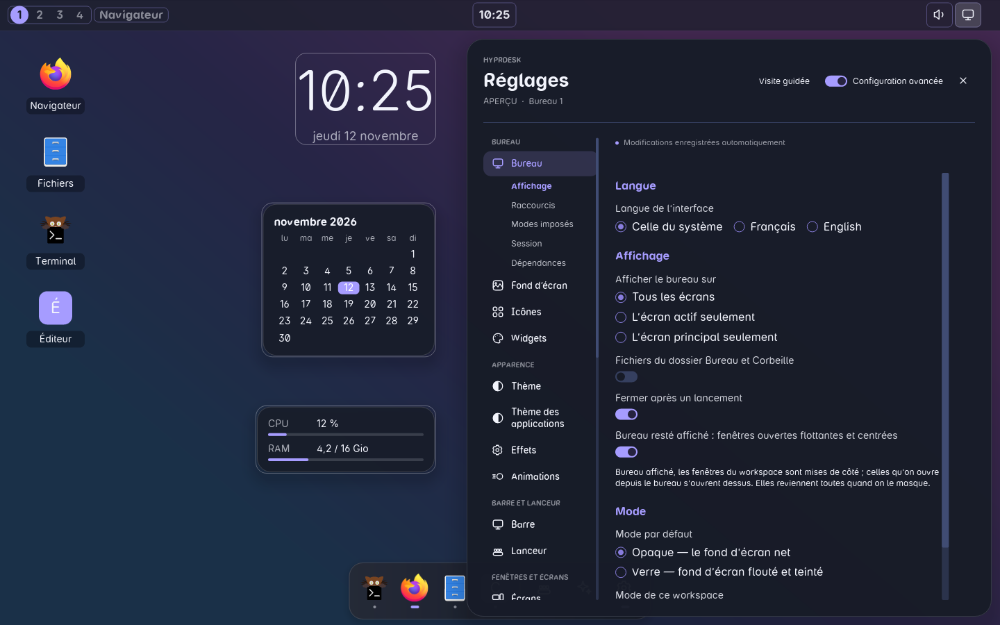<br><sub><b>Bureau</b> — écrans affichés, mode du bureau, raccourcis et leurs conflits avec hyprland.lua</sub></td>
    <td width="50%" valign="top">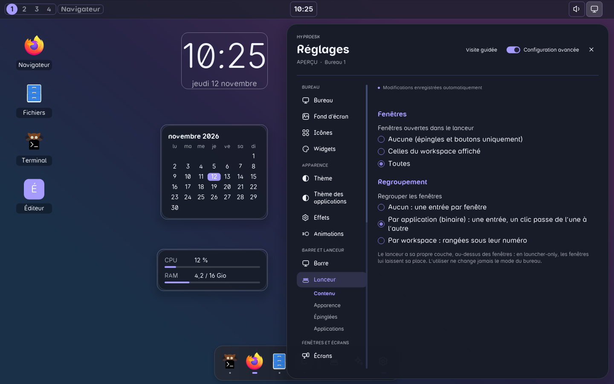<br><sub><b>Lanceur</b> — fenêtres du dock, regroupement, apparence, épinglées, icônes SmartUI</sub></td>
  </tr>
  <tr>
    <td width="50%" valign="top">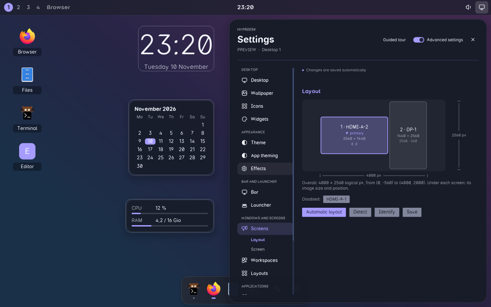<br><sub><b>Écrans</b> — disposition sur un plan à l'échelle, mode, rotation, échelle ; retour seul au bout de 12 s</sub></td>
    <td width="50%" valign="top">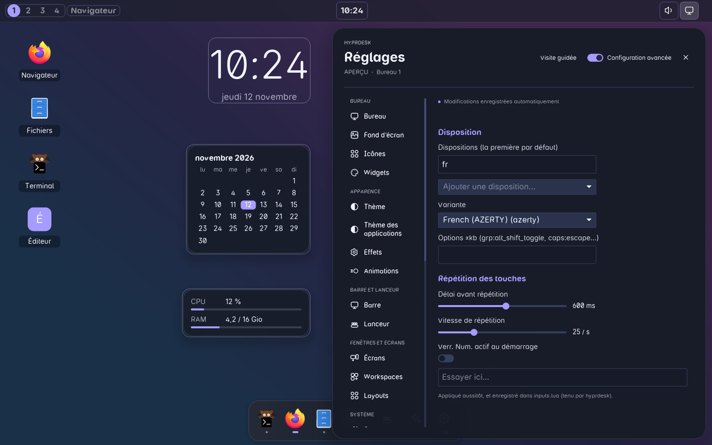<br><sub><b>Clavier et souris</b> — dispositions et variantes, répétition, pavé tactile, zone d'essai</sub></td>
  </tr>
  <tr>
    <td width="50%" valign="top">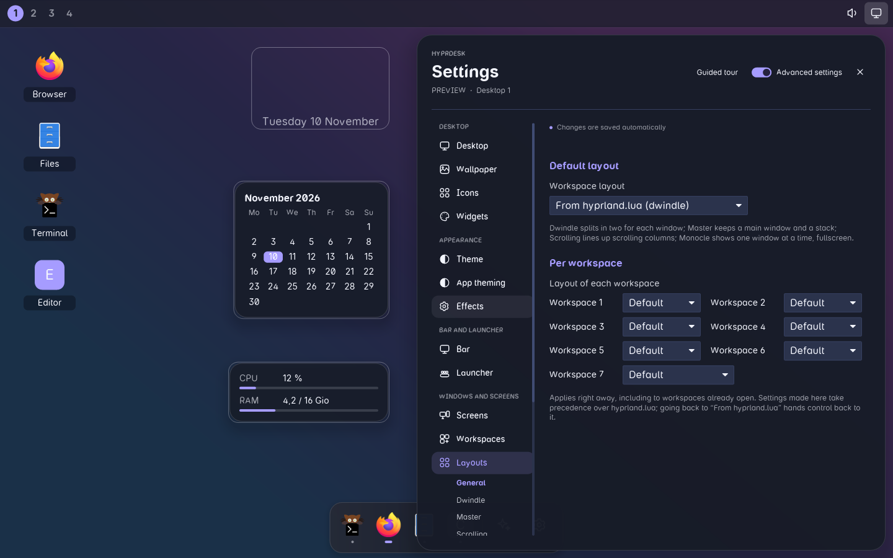<br><sub><b>Layouts</b> — Dwindle, Master, Scrolling, Monocle, par workspace</sub></td>
    <td width="50%" valign="top">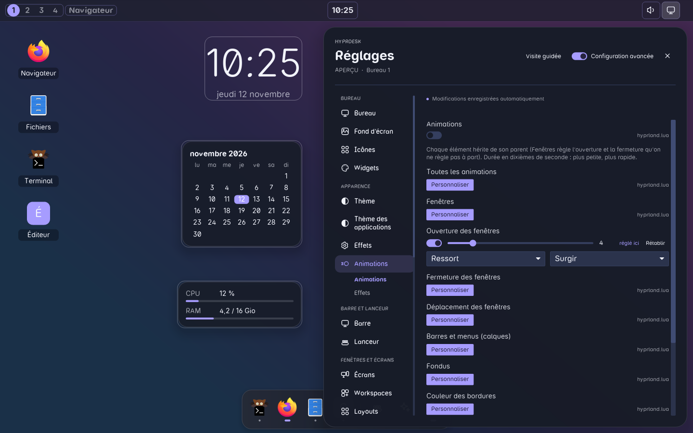<br><sub><b>Animations</b> — animations et effets de Hyprland, en direct</sub></td>
  </tr>
  <tr>
    <td width="50%" valign="top">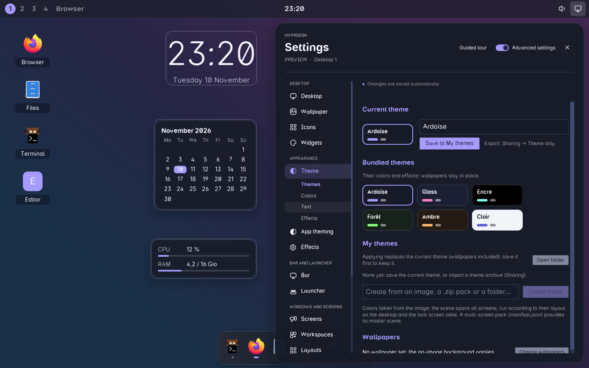<br><sub><b>Thème</b> — thèmes livrés, thèmes créés depuis une image, couleurs et effets</sub></td>
    <td width="50%" valign="top">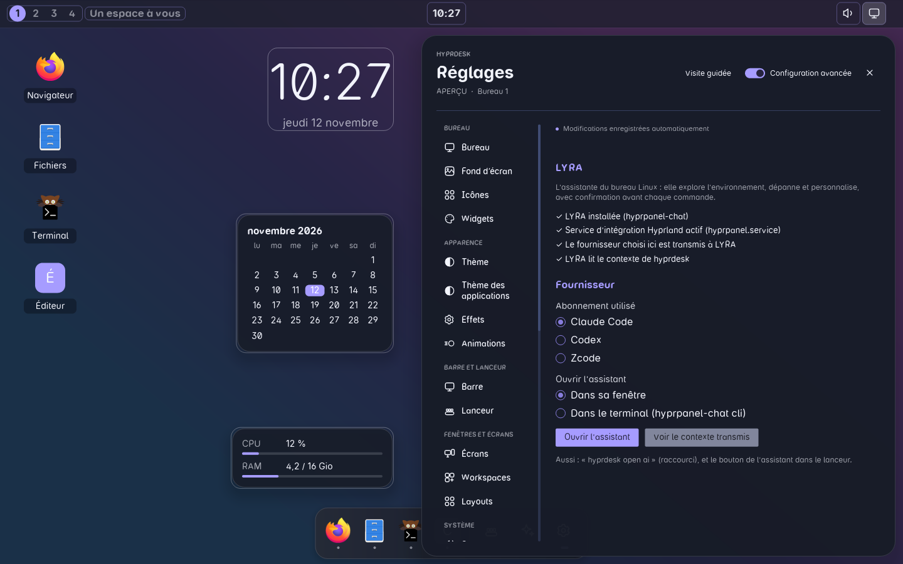<br><sub><b>IA → Assistant</b> — LYRA, son abonnement et ce qu'elle sait</sub></td>
  </tr>
  <tr>
    <td width="50%" valign="top">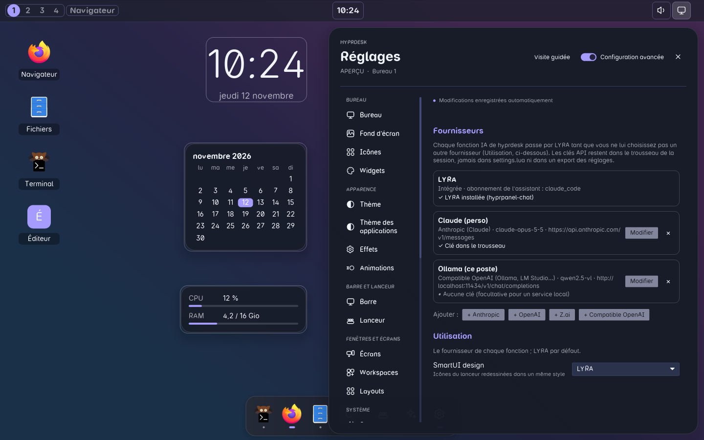<br><sub><b>IA → Autres services IA</b> — fournisseurs, et le fournisseur de chaque fonction ; clés au trousseau</sub></td>
    <td width="50%" valign="top">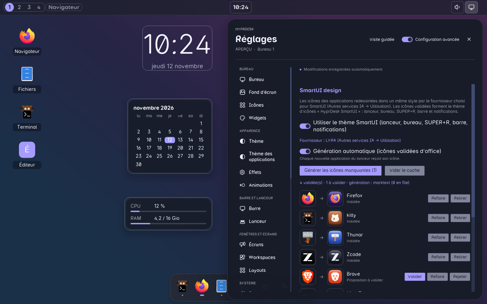<br><sub><b>IA → SmartUI design</b> — icônes redessinées par l'IA, validées ou générées automatiquement</sub></td>
  </tr>
  <tr>
    <td width="50%" valign="top">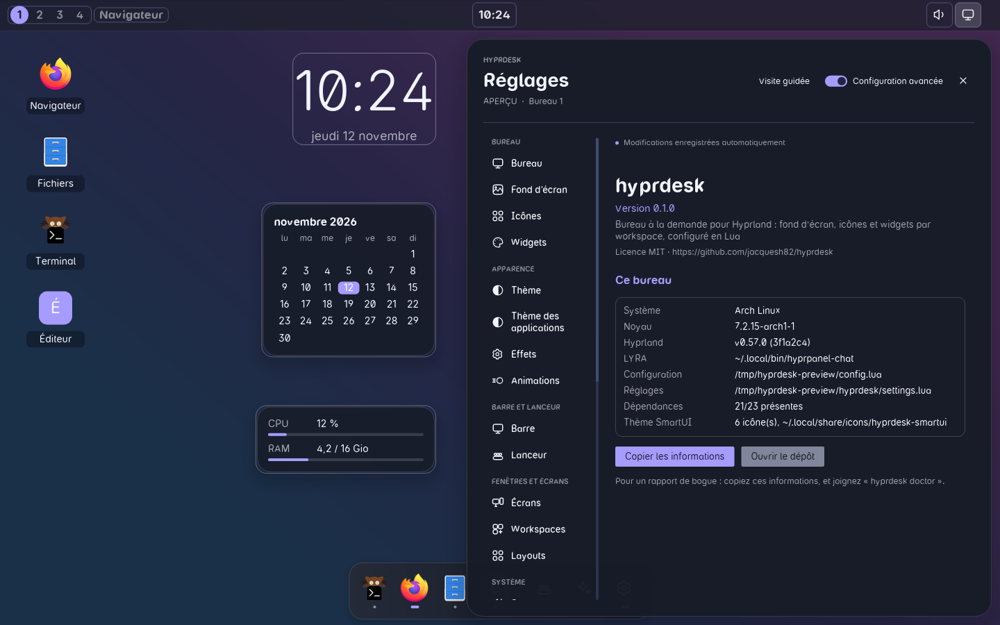<br><sub><b>À propos</b> — version, système, Hyprland, LYRA ; copie pour un rapport de bogue</sub></td>
  </tr>
</table>

## LYRA, IA embarquée

LYRA est l'assistante du bureau Linux : hyprdesk l'embarque et lui donne tout
ce qu'il faut pour aider. Sans elle, hyprdesk fonctionne pareil ; seules les
fonctions IA restent éteintes.

- **À un clic** — le bouton LYRA du dock, ou `hyprdesk assistant`, ouvre son
  tiroir à côté des fenêtres, sans changer le mode du bureau ; le même clic
  le referme. Plusieurs conversations peuvent tourner en même temps (chacune
  avec son moteur), avec images collées, réponses en Markdown, blocs de code
  copiables et liens.
- **Elle connaît votre bureau** — hyprdesk décrit tout son environnement en
  Markdown (modes, paquets de réglages, applications, écrans, workspaces,
  widgets, fichiers, commandes) dans le dossier de contexte de LYRA
  (`~/.config/hyprpanel/context.d/hyprdesk.md`) ; `hyprdesk context`
  l'imprime, et « Voir le contexte transmis » le montre dans les Réglages.
- **Rien dans votre dos** — des réponses typées, pas seulement du texte :
  exécutions d'outils avec leur état et leur résultat ; **cartes de
  confirmation** montrant la commande, sa raison et son risque avant de
  l'accepter ou de la refuser ; **cartes de choix avec aperçu en direct**
  (une couleur, un écart…) appliqué seulement une fois accepté.
- **De l'aide là où il en faut** — des boutons « Demander à LYRA » dans les
  Réglages ouvrent une conversation déjà remplie avec le problème : conflit
  de raccourcis, service tenu par un autre programme, trousseau, mise à jour
  en échec. `hyprdesk ask <titre> <texte>` fait de même depuis un script.
- **Votre abonnement, sans clé API** — Claude Code, Codex ou Zcode, choisi
  dans Réglages → IA → Assistant ou dans l'en-tête du tiroir.
- **L'IA de tout le bureau** — les autres fonctions IA de hyprdesk passent
  par LYRA par défaut. Réglages → IA → Autres services IA permet aussi
  d'ajouter des fournisseurs (Anthropic, OpenAI, Z.ai, tout endpoint
  compatible OpenAI comme Ollama) et d'en choisir un par fonction (`ai_services`,
  `ai_use`) ; les clés API restent dans le trousseau de la session, jamais
  dans un fichier de configuration.
- **SmartUI design** — Réglages → IA → SmartUI design : les icônes des
  applications redessinées par l'IA dans un même style (façon iOS/macOS par
  défaut, ou votre propre consigne). Les icônes validées forment le thème
  d'icônes `hyprdesk-smartui` (`~/.local/share/icons`, hérite de votre
  thème), utilisé partout : dock, bureau, `SUPER + R`, barre et
  notifications. La génération automatique, active par défaut quand LYRA est
  installée, donne son icône à chaque nouvelle application du lanceur.

<p align="center">
  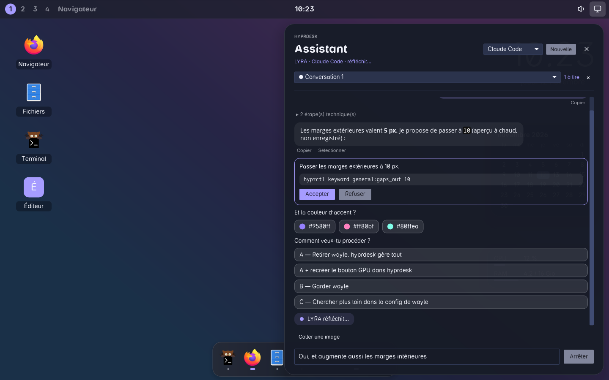
</p>

LYRA elle-même (`hyprpanel-chat`) vient de
[mindlog.hyprland_tools](https://github.com/jacquesh82/mindlog.hyprland_tools). Le script d'installation la compile et l'installe par
défaut (`--no-lyra` pour s'en passer ; `HYPRDESK_LYRA_REF` choisit la
branche), avec son service d'intégration, qui démarre avec hyprdesk.

<p align="center">
  
</p>

## Widgets plug-n-play

Les widgets intégrés sont `clock`, `calendar`, `system` et `media`, plus
`command` et `lua`, qui se déclarent dans le Lua. Pour en ajouter un autre, il
suffit de déposer un fichier Lua dans `~/.config/hypr/hyprdesk/widgets/`, sans
rien recompiler :
- le fichier est détecté aussitôt ;
- il apparaît dans Réglages → Widgets, où on l'active d'un clic ;
- on peut aussi l'utiliser en Lua avec `hd.widget("<nom>", { … })`.

```lua
-- ~/.config/hypr/hyprdesk/widgets/meteo.lua
return {
    name = "Météo", description = "wttr.in", interval = 900, anchor = "top-left",
    options = { ville = "Paris" },                       -- valeurs par défaut
    render = function(o)
        return hd.exec("curl -s 'wttr.in/" .. o.ville .. "?format=3'")
    end,
}
```

Un plugin peut faire plus que du texte. C'est ce qui permet d'ajouter à la
barre tout ce qui manque, de façon classique :

```lua
return {
    name = "VPN", description = "État du VPN", interval = 5, anchor = "top-right",
    options = { interface = "wg0" },
    -- texte, ou table : icône (de préférence « …-symbolic », teintée selon le thème),
    -- info-bulle, état (normal, active, warning, critical, hidden)
    render = function(o)
        local up = hd.exec("ip link show " .. o.interface .. " 2>/dev/null") ~= ""
        return { icon = up and "network-vpn-symbolic" or "network-vpn-disabled-symbolic",
                 tooltip = up and "VPN actif" or "VPN coupé", state = up and "active" or "normal" }
    end,
    on_click  = function(o) end,              -- clic (clic droit si un menu existe)
    on_scroll = function(o, sens) end,        -- molette : +1 / -1
    menu = function(o)                        -- menu déroulant sous le module
        return {
            { header = "VPN" },
            { label = "Connecter", icon = "network-vpn-symbolic", action = function() hd.spawn("wg-quick up wg0") end },
            "-",
            { label = "Tout couper…", confirm = "Couper le VPN ?", action = function() hd.exec("wg-quick down wg0") end },
        }
    end,
}
```

- **`hd.exec(cmd)`** rend la sortie d'une commande.
- **`hd.spawn(cmd)`** lance un programme sans attendre, par Hyprland.
- **Entrées de menu** : `label`, `detail`, `icon`, `checked`, `disabled`,
  `action` et `confirm`. Une entrée avec `confirm` demande une confirmation
  dans le menu même.

**Plugins livrés.** Ils sont intégrés au binaire, et un fichier du même nom
les remplace :

| Plugin | Rôle |
|---|---|
| `reseau` | filaire et Wi-Fi, réseaux à proximité, connexion, activation du Wi-Fi |
| `bluetooth` | activation, appareils appairés (connexion, déconnexion) |
| `batterie` | batterie de l'ordinateur et des périphériques (souris, clavier) ; masqué s'il n'y en a pas |
| `capture` | captures (zone, fenêtre, écran) et enregistrement de l'écran, indicateur rouge pendant l'enregistrement |
| `clavier` | disposition du clavier active ; menu pour choisir, molette pour passer à la suivante |
| `lecteur` | morceau en cours (MPRIS) ; menu : position, précédent, lecture / pause, suivant, ±10 s ; molette : ±10 s |
| `majs` | mises à jour en attente, mise à jour en un clic |
| `supports` | clés USB et disques externes : notification au branchement, ouvrir, éjecter ; masqué s'il n'y en a pas |
| `nuit` | éclairage nocturne (hyprsunset) : horaire ou à la demande, température ; laisse la main à wlsunset/gammastep s'ils tournent |
| `vkbd` | clavier virtuel (wvkbd) : afficher ou masquer ; masqué si wvkbd est absent |
| `notifications` | Ne pas déranger, dernières notifications, tout effacer (service de wayle) |
| `session` | verrouiller, veille, déconnexion, redémarrage, extinction (avec confirmation) |

**Modules propres à la barre.**
- `workspaces` : pastilles ; clic pour y aller, molette pour passer d'un
  workspace à l'autre.
- `window` : titre de la fenêtre active.
- `volume` : menu avec curseur et coupure ; clic du milieu pour couper,
  molette pour régler.
- `tray` : zone de notification. Clic pour activer l'application, clic
  droit pour son menu natif (dbusmenu).
- `desktop` : bouton qui affiche ou masque le bureau vide.

L'horloge ouvre un calendrier. `hyprdesk menu <module>` ouvre un menu au
clavier, par exemple `hyprdesk menu volume` ou `hyprdesk menu reseau`.

Emplacements des plugins :
- un fichier `<nom>.lua`, ou un dossier `<nom>/init.lua` ;
- cherchés aussi dans `~/.local/share/hyprdesk/widgets` et
  `/usr/share/hyprdesk/widgets` ; le premier dossier trouvé l'emporte ;
- `hyprdesk init` installe deux exemples : `meteo` et `notes`.

Un plugin en erreur est signalé dans les réglages sans bloquer le reste.

Dans Réglages → Widgets, chaque interrupteur reflète l'état réel du bureau,
que le widget vienne des réglages ou de `hyprdesk.lua`. Éteindre un widget de
`hyprdesk.lua` écrit `hd.disable("clock#0")` dans `settings.lua`, sans
modifier votre fichier. Le rallumer retire cette ligne.

Pour repositionner un widget déclaré dans `hyprdesk.lua`, on utilise
`hd.place("clock#0", { anchor = "top", y = 20 })`. Quand on le déplace depuis
les réglages, c'est ce `hd.place` qui est écrit dans `settings.lua`.

**Plusieurs écrans.** Un widget du bureau ne s'affiche que sur un écran :
l'écran principal par défaut. Réglages → Widgets → Écran (ou `screen = …`)
en choisit un autre, ou tous, et ce qui se passe quand cet écran est
débranché : le widget passe sur l'écran principal, ou se masque. Les widgets
ne se superposent jamais : celui qui en recouvrirait un autre glisse en
dessous (au-dessus pour un ancrage en bas), ou à côté quand la colonne est
pleine.

```lua
hd.widget("clock",    { screen = "DP-2", if_missing = "primary" }) -- "primary" (défaut), "all", ou un nom d'écran
hd.widget("calendar", { screen = "DP-2", if_missing = "hide" })
hd.place("clock#0",   { screen = "all" })                           -- un widget de hyprdesk.lua sur tous les écrans
```

Les réglages sont enregistrés en Lua généré, dans
`~/.config/hypr/hyprdesk/settings.lua`, comme le fait hyprdmc pour
`monitors.lua`. Ce fichier est chargé **avant** `hyprdesk.lua` : tout ce que vous
écrivez à la main garde le dernier mot. Votre fichier n'est jamais réécrit, et le
panneau signale les réglages que `hyprdesk.lua` surcharge.

### Menus du bureau

- Clic droit sur le fond du bureau : aligner les icônes, ajouter un widget,
  changer de fond d'écran, réglages du bureau, Propriétés (écran, workspace,
  mode, fond, thème, icônes et widgets).
- Réglages ouverts, clic droit sur un widget : le retirer du bureau, ses
  réglages, ses Propriétés.
- Clic droit sur une icône : ouvrir, épingler au dock, renommer, retirer du
  bureau (et pour un fichier : dossier, corbeille, chemin, fond d'écran),
  Propriétés.
- Les Propriétés se copient.

## Installation

### Prérequis

- Linux x86_64 ou aarch64, avec systemd (session utilisateur ouverte, pas
  `su` ni `sudo -i`) ;
- **Hyprland 0.57 ou plus**, installé et lancé (plus ancien, l'installation le
  met à jour ; il faut ensuite se reconnecter) ;
- un pilote Vulkan ou GL ;
- un gestionnaire de paquets reconnu : pacman (Arch), apt (Debian, Ubuntu),
  dnf (Fedora) ou zypper (openSUSE), et les droits `sudo` ;
- environ 4 Gio libres pour compiler (8 Gio si LYRA est à compiler), et un
  accès à GitHub et crates.io.

Le reste (compilateur, bibliothèques, Rust récente…) est installé par le
script. Rien n'est à préparer à la main.

### Installer

```bash
git clone https://github.com/jacquesh82/hyprdesk && cd hyprdesk
./scripts/install.sh
```

Dans un terminal et sans option, le script ouvre l'**assistant** (fenêtres
whiptail s'il est là, sinon questions au terminal), en 5 étapes :

1. **Langue** de hyprdesk et des messages.
2. **Contrôles préalables** : les prérequis ci-dessus. S'il en manque un,
   l'installation s'arrête **avant toute modification**, avec la marche à
   suivre ; si seul Hyprland est trop ancien, l'assistant propose de le
   mettre à jour.
3. **Clavier** de la session (celui en vigueur en tête de liste).
4. **Options**, à cocher : LYRA, myMFA, prérequis manquants, démarrage à la
   connexion, `SUPER + L` pour verrouiller, retrait de hyprpaper, même clavier
   pour le système, écran de connexion de hyprdesk à la place de GDM (SDDM,
   LightDM) — proposé seulement si greetd et cage sont présents ou
   installables.
5. **Récapitulatif** : rien n'est modifié avant votre confirmation.

### Étapes de l'installation

L'installation se déroule ensuite en étapes numérotées, avec une barre de
progression. Les commandes longues tournent avec une animation, leur dernière
ligne et le temps écoulé ; leur sortie complète va dans
`~/.local/state/hyprdesk/install-<date>.log`.

| Étape | Ce qui se passe |
|---|---|
| 🔎 Contrôles préalables | les critères de base, revus avant de toucher à quoi que ce soit |
| 📦 Prérequis de construction | paquets de la distribution absents (avec `sudo`), Hyprland 0.57+, Rust : si celle du poste est trop ancienne, rustup installe la dernière stable dans `~/.cargo`, sans toucher à celle de la distribution |
| 🦀 Compilation | `cargo build --release` (3 à 10 min la première fois) |
| 🔤 Police · 📥 Binaire · 🛠 Configuration | police Mindlog, `hyprdesk` dans `~/.local/bin`, `~/.config/hypr/hyprdesk.lua` s'il manque (une configuration existante est gardée) |
| 🤖 LYRA | l'assistante IA, compilée depuis [mindlog.hyprland_tools](https://github.com/jacquesh82/mindlog.hyprland_tools), avec son service, qui démarre avec hyprdesk ; déjà installée : gardée |
| 🔑 myMFA | le trousseau (mots de passe, codes 2FA) : démon, Secret Service, module PAM qui ouvre le coffre à la connexion. « Déjà installé » exige le binaire **et** son activation D-Bus ; sinon l'installation est refaite. Il est cloné depuis son dépôt GitHub **public** ([lelabnet-creator/mindlog.mymfa.clients](https://github.com/lelabnet-creator/mindlog.mymfa.clients)), avec la clé SSH du poste ou un `gh` connecté en repli, ou une copie locale (`HYPRDESK_MYMFA_SRC`) ; l'étape reste facultative (`--no-mymfa`) et est sautée sans rien bloquer si le dépôt est inaccessible. Chaque issue (déjà installé, accès utilisé, dépôt inaccessible, échec, `--no-mymfa`) est écrite au journal |
| 🪟 Hyprbars | les barres de titre du plein bureau : `hyprpm`, `cmake`, `meson` et `cpio` s'ils manquent, puis `hyprpm update` et `hyprpm add` (2 à 5 min, un second essai), contre le Hyprland qui tourne, donc seulement dans une session Hyprland. hyprpm tourne au premier plan, car il demande lui-même le mot de passe `sudo` ; déjà compilé : gardé |
| 🌍 Langue · ⌨ Clavier | si choisis : langue de hyprdesk, clavier dans `inputs.lua` (et pour le système avec `localectl`) |
| 🩺 Dépendances facultatives | celles qui manquent (veille, captures, Bluetooth, écran de connexion…) : celles des dépôts sont proposées à l'installation (toutes, aucune, ou par numéros), les autres sont montrées avec leur commande AUR |
| 🔁 Service | service systemd utilisateur, démarré aussitôt dans une session Hyprland |
| 🚀 Démarrage à la connexion | une ligne dans `hl.on("hyprland.start")` de `hyprland.lua` : hyprdesk démarre même quand la distribution n'active pas `graphical-session.target` |
| 🔐 `SUPER + L` · 🖼 hyprpaper | si choisis : verrouillage par hyprdesk ; hyprpaper retiré de l'autostart |
| 🚪 Écran de connexion | si choisi : greetd et l'écran de hyprdesk (clavier, thème, écrans de la session ; son logo et son fond, horizontal ou vertical selon l'écran) |

`hyprland.lua` est sauvegardé avant chaque modification
(`hyprland.lua.avant-hyprdesk-*.bak`). Relancer l'installation est sans
danger : ce qui est déjà en place est reconnu et laissé.

### À la fin

- un **bilan vérifié** point par point : binaire, configuration, service,
  version de Hyprland en cours, hyprdesk qui répond, configuration de Hyprland
  sans erreur, démarrage à la connexion, LYRA, myMFA (installé, puis qui
  répond), Hyprbars, clavier, langue, écran de connexion ;
- **ce qu'il reste à faire** pour que hyprdesk tourne, chaque point avec sa
  commande : ouvrir une session Hyprland, se reconnecter après une mise à jour
  de Hyprland, redémarrer pour l'écran de connexion… puis le facultatif
  (paquets absents, `~/.local/bin` dans le `PATH`, abonnement pour LYRA,
  coffre myMFA à créer) ;
- un **verdict** : en marche, installé avec des actions restantes, ou pas
  encore fonctionnel.

Au premier démarrage, les Réglages s'ouvrent d'eux-mêmes. La configuration
par défaut affiche la barre en haut, dans tous les modes.

### Sans questions

Avec des options, ou sans terminal (scripts, conteneurs), le script installe
directement. `./scripts/install.sh --help` les liste :

| Option | Effet |
|---|---|
| `--defaults` | choix par défaut, sans assistant |
| `--lang fr\|en\|auto` | langue de hyprdesk et des messages |
| `--keyboard fr:azerty` | clavier de la session (`disposition[:variante[:options]]`) |
| `--system-keyboard` | le même clavier pour le système (TTY, autre écran de connexion) |
| `--greeter` / `--no-greeter` | remplacer GDM par l'écran de hyprdesk, ou non (sinon : question) |
| `--optional-deps ask\|all\|none` | dépendances facultatives : proposées, toutes installées, ou non |
| `--no-lyra` · `--no-mymfa` · `--no-hyprbars` | sans LYRA, sans myMFA, sans les barres de titre Hyprbars |
| `--no-deps` | ne pas installer les prérequis (à la main ; `scripts/deps.sh --dry-run` montre ce qui manque) |
| `--no-autostart` · `--no-lock-key` · `--remove-hyprpaper` | démarrage à la connexion, `SUPER + L`, hyprpaper |
| `--verbose` | sortie complète des commandes à l'écran |

Variables utiles : `HYPRDESK_LYRA_REF` (branche de LYRA, par défaut celle du
mode `serve` dont le tiroir a besoin), `HYPRDESK_LYRA_SRC` et
`HYPRDESK_MYMFA_SRC` (copies locales), `HYPRDESK_INSTALLER_TUI=0` (assistant au
terminal même avec whiptail), `NO_COLOR=1` ou `HYPRDESK_COLOR=0` (sans
couleurs), `HYPRDESK_ASCII=1` (icônes ASCII).

### Mettre à jour

```bash
./scripts/update.sh             # ce qui a changé, puis la mise à jour après confirmation
./scripts/update.sh --check     # le relevé seulement (code 10 : mise à jour disponible)
./scripts/update.sh --yes       # sans question
```

Le relevé montre les commits à récupérer et les domaines touchés (code,
scripts, ressources, traductions, documentation), une version installée en
retard sur le dépôt, LYRA et myMFA s'ils ont changé, et la copie de hyprdesk
utilisée par l'écran de connexion. La mise à jour récupère les commits (pas
s'il y a des modifications locales : rien n'est écrasé), réinstalle avec les
options de la dernière installation, recompile LYRA et myMFA s'il le faut, et
rafraîchit l'écran de connexion.

### En cas de problème

- Une étape qui échoue arrête l'installation en disant laquelle, les dernières
  lignes de l'erreur et la piste de correction ; le journal complet est dans
  `~/.local/state/hyprdesk/install-<date>.log`. Corrigez, puis relancez.
- hyprdesk ne démarre pas : `journalctl --user -u hyprdesk -n 50` ;
  `hyprdesk doctor` liste les dépendances et ce qui en dépend.
- Dans les Réglages, les boutons « Demander à LYRA » confient un problème à
  l'assistante (elle demande avant de modifier quoi que ce soit).
- myMFA absent : vérifier l'accès réseau à son dépôt GitHub public, ou
  renseigner `HYPRDESK_MYMFA_SRC=<copie des sources>`, puis relancer
  `./scripts/install.sh` ; le journal dit pourquoi l'étape a été sautée, la
  page Réglages → Mots de passe aussi.
- Hyprbars absent : dans un terminal, sous Hyprland,
  `hyprpm update && hyprpm add https://github.com/hyprwm/hyprland-plugins`
  (hyprpm demande le mot de passe).
- Revenir à l'écran de connexion d'avant : `sudo hyprdesk greeter setup restore`.

### Désinstaller

```bash
systemctl --user disable --now hyprdesk.service
sudo hyprdesk greeter setup restore      # si l'écran de connexion de hyprdesk est en place
rm ~/.local/bin/hyprdesk
```

Retirez ensuite de `hyprland.lua` les lignes marquées « hyprdesk » (démarrage
à la connexion, `SUPER + L`, `require("autostart")`), ou reprenez une copie
`hyprland.lua.avant-hyprdesk-*.bak`. Votre configuration
(`~/.config/hypr/hyprdesk.lua`, `settings.lua`) reste en place.

### hyprdesk à la racine de la session

Les lignes recommandées pour `hyprland.lua` s'obtiennent avec
`hyprdesk snippet` : le marquage `submap_universal` des raccourcis à garder
sur le bureau (voir ci-dessous), et le flou derrière la barre. Pour que
hyprdesk soit la racine de la session :
- retirez de l'autostart de Hyprland ce qu'il supervise désormais
  (`hd.component`, ou Réglages → Démarrage automatique) ;
- retirez `hyprpaper` ;
- masquez la barre de votre shell si vous gardez celle de hyprdesk.

## Raccourcis

- **Les raccourcis de hyprdesk sont installés par hyprdesk lui-même**, avec
  ceux de `hd.config({ keys = … })` ou de Réglages → Bureau :
  - `toggle`, `SUPER + D` par défaut, affiche ou masque le bureau ;
  - `settings`, `SUPER + SHIFT + D` par défaut, ouvre les réglages (bureau
    affiché compris, sans changer de mode) ;
  - `lock` verrouille la session (`hyprdesk lock`). Non réglé par défaut :
    c'est le `SUPER + L` de `hyprland.lua`, posé par `scripts/install.sh`.
    Réglé dans hyprdesk, il le remplace (la combinaison est libérée) ;
  - `leave`, `SUPER + Escape` par défaut, est la sortie de secours.

  Ils sont réinstallés après chaque `hyprctl reload`.
- **Pas de conflit avec Hyprland.** Avant d'installer un raccourci, hyprdesk
  vérifie qu'il n'est pas déjà lié. S'il l'est, il ne l'installe pas hors du
  bureau (celui de `hyprland.lua` reste maître) et le signale par une
  notification et dans les réglages ; bureau affiché, les raccourcis de
  Hyprland étant suspendus, hyprdesk l'installe quand même.
- **Bureau affiché, les raccourcis de Hyprland sont suspendus.** hyprdesk
  active la submap `hyprdesk` : SUPER + Q, SUPER + F, etc. ne visent plus
  les fenêtres. Dès qu'une fenêtre est ouverte depuis le bureau, ils sont
  rendus pour agir sur elle. Pendant la suspension, restent actifs :
  - les raccourcis de hyprdesk ;
  - ceux que vous marquez `{ submap_universal = true }` dans `hyprland.lua`,
    typiquement le changement de workspace, et le bureau suit alors.

  `suspend_binds = false` désactive ce comportement.
- **On ne reste jamais bloqué.** Les raccourcis de la submap rendent la main
  à Hyprland *avant* d'appeler hyprdesk. Au démarrage, hyprdesk referme une
  submap laissée ouverte par un arrêt brutal.

Pensez aussi à retirer `hyprpaper` de l'autostart.

## Une seule instance

Un seul démon tourne par session : il tient un verrou exclusif (`flock`) sur
`$XDG_RUNTIME_DIR/hypr/<instance>/hyprdesk.lock` pendant toute sa vie.
- **Seconde instance** : qu'elle vienne du service, d'un `hl.exec_cmd` ou d'un
  lancement manuel, elle signale celle en place (son PID) et s'arrête sans
  erreur. systemd ne la relance donc pas en boucle.
- **Remplacement** : `hyprdesk daemon --replace` remplace proprement
  l'instance en place. Le service systemd démarre ainsi.
- **Arrêt propre** : sur `SIGTERM` (`systemctl --user stop`) ou `SIGINT`,
  hyprdesk rend leur configuration d'origine aux fenêtres du plein bureau et
  retire ses raccourcis.
- **Arrêt brutal** : le noyau libère le verrou ; au démarrage suivant,
  hyprdesk rend les fenêtres restées de côté.

## Commandes

| Commande | Effet |
|---|---|
| `hyprdesk` / `hyprdesk daemon` | lance le démon (une seule instance par session) |
| `hyprdesk daemon --replace` | remplace proprement l'instance en place |
| `hyprdesk show` (`full-desktop`) · `launcher-only` · `hide` (`no-desktop`) | les trois modes du bureau : complet (fenêtres flottantes par-dessus, organisées), lanceur seul (dock accessible, les fenêtres en mosaïque lui laissent la place), masqué. Le mode est celui du workspace : chaque écran prend le mode du workspace qu'il affiche, un changement ne touche que le workspace de l'écran actif, et chaque workspace retrouve le sien en y revenant, d'une session à l'autre (no-desktop tant qu'on n'en a pas choisi). Un mode imposé à un écran ou à un workspace (Réglages → Bureau → Modes imposés) s'applique en y arrivant, sans faire changer les autres écrans |
| `hyprdesk toggle` · `toggle-launcher` | full-desktop / launcher-only, ou no-desktop si on y est déjà (raccourcis SUPER + D, SUPER + ALT + D ; SUPER + CTRL + D : no-desktop) |
| `hyprdesk cycle` | mode suivant : no-desktop → launcher-only → full-desktop → no-desktop (bouton Bureau de la barre ; clic droit : no-desktop) |
| `hyprdesk settings [paquet]` | ouvre les réglages sans changer le mode du bureau (`desktop`, `launcher`, `screens`, `fond`…) |
| `hyprdesk theme [list]` · `theme new <image\|pack.zip\|dossier> [--name NOM]` · `theme apply <nom>` | « Mes thèmes » ; un thème tiré d'une scène (couleurs de l'image, scène étalée sur tous les écrans, bureau et verrouillage) |
| `hyprdesk wallpaper split <image> [dossier] [--scale N]` | découpe une scène selon la disposition des écrans : une image par écran |
| `hyprdesk export [fichier] [--theme] [--screens]` · `hyprdesk import <archive> [--theme] [--dry-run] [--screens]` | partager son setup : configs, plugins, fonds d'écran — ou, avec `--theme`, le thème seul (couleurs, fonds, effets) ; l'import sauvegarde l'actuel |
| `hyprdesk open <rôle>` · `hyprdesk context` · `hyprdesk assistant` | application par défaut d'un rôle (`browser`, `terminal`, `ai`…) ; contexte Markdown de l'environnement pour l'assistant ; ouvre ou referme le tiroir de l'assistant, sans changer le mode du bureau |
| `hyprdesk config [list [paquet]] \| get \| set \| unset` | réglages en ligne de commande, par paquet, écrits dans `settings.lua` comme depuis l'écran (ex. `hyprdesk config set launcher_group app`) |
| `hyprdesk reload` | relit la configuration (elle est aussi relue à chaque enregistrement) |
| `hyprdesk status` | état : affiché ou caché, workspaces, config en erreur ou non |
| `hyprdesk check [fichier]` | vérifie une configuration sans toucher au démon |
| `hyprdesk doctor` | dépendances externes (hypridle, wpctl, nmcli, portails…) : présentes ou absentes, et ce qui en dépend ; aussi dans Réglages → Bureau → Dépendances (configuration avancée) |
| `hyprdesk init` · `stubs` · `snippet` | config d'exemple, définitions LuaLS, lignes pour `hyprland.lua` |

Au clavier, le dock se pilote sans souris : ouvert par `toggle-launcher` ou
`launcher-only`, il prend le clavier, première case choisie (Tab y descend
depuis le plein bureau). Flèches, Tab et Maj + Tab changent de case, Début et
Fin vont aux bouts, Entrée ou Espace l'activent et rendent le clavier, Échap
referme le dock (ou remonte au plein bureau).

Options et variables :
- `--config <fichier>` ou `$HYPRDESK_CONFIG` : fichier de configuration à utiliser ;
- `$HYPRDESK_LOG` : niveau de journal (`debug`, `info`…).

## Écrans — `~/.config/hypr/monitors.lua`

hyprdesk gère les écrans (il remplace hyprdmc) : l'onglet **Écrans** détecte
les sorties, les place, les tourne, règle mode et échelle, et désigne l'écran
principal. Un changement s'applique à chaud ; **Garder** l'écrit dans
`monitors.lua` (requis par `hyprland.lua` : `require("monitors")`), sinon
l'affichage d'avant revient seul. Les écrans débranchés gardent leur ligne, et
un écran inconnu est accueilli en mode préféré, placé automatiquement. Un
`monitors.lua` écrit par un autre outil est conservé une fois en
`monitors.lua.bak`.

## Configuration — `~/.config/hypr/hyprdesk.lua`

```lua
hd.config({ mode = "opaque", show_on = "all", running_apps = "workspace", icon_theme = "Papirus-Dark",
            transition = "slide", fade_ms = 150, crossfade_ms = 700,
            grid = { cell = 96, gap = 16, margin = 32, icon_size = 48 },
            theme = { fg = "#f8f8f2", bg = "#22212c", accent = "#9580ff" } })

hd.wallpaper({ path = "~/.wallpapers/default.jpg" })                       -- partout
hd.wallpaper({ monitor = "DP-1", path = "~/.wallpapers/portrait.png" })    -- un écran
hd.wallpaper({ workspace = 3, rotate = { dir = "~/.wallpapers", interval = 600, shuffle = true } })
hd.desktop({ workspace = 4, mode = "glass" })
hd.desktop({ workspace = "special:magic", inherit = false })               -- sans les éléments globaux

hd.config({ primary = "HDMI-A-2", show_on = "primary" })                  -- écran principal
hd.bar({ monitor = "primary" })                                            -- barre sur l'écran principal
-- Écrans étroits ou verticaux : barre compacte (auto), et modules propres aux écrans verticaux.
hd.bar({ compact = "auto", left = { "workspaces", "window" }, right = { "tray", "volume", "session" },
         portrait = { left = { "workspaces" }, right = { "volume", "session" } } })

hd.config({ workspaces = 7 })                                              -- 1 à 7 toujours présents
hd.config({ workspace_monitors = { ["HDMI-A-2"] = { 1, 2, 3, 4, 5 }, primary = { 6, 7 } } }) -- écran de chaque workspace
hd.assign({ app = "firefox", workspace = 2 })                              -- s'ouvre sur 2, et y emmène
hd.assign({ class = "^(org\\.telegram\\..*)$", workspace = 5, silent = true }) -- sans y aller

hd.icon({ app = "firefox" })                                               -- identifiant .desktop
hd.icon({ workspace = 2, label = "Projets", path = "~/Documents/DEV", pos = { 0, 1 } })
hd.icon({ label = "htop", exec = "htop", terminal = true, icon = "utilities-system-monitor" })

hd.widget("clock",    { anchor = "top-right", format = "%H:%M", size = 72, card = false })
hd.widget("calendar", { anchor = "right" })
hd.widget("system",   { anchor = "bottom-right", show = { "cpu", "ram", "disk:/", "uptime" } })
hd.widget("media",    { anchor = "bottom", player = "*" })
hd.widget("command",  { exec = "curl -s 'wttr.in/?format=3'", interval = 900 })
hd.widget("lua",      { interval = 5, render = function() return os.date("%A") end })

hd.on("show", function(e) print(e.monitor, e.workspace) end)               -- show, hide, workspace
```

**Sélecteurs.** Chaque règle accepte `workspace` et `monitor` (une chaîne, un
nombre, une liste, ou `"*"`). Les règles se combinent ainsi :
- pour le fond d'écran et le mode, la règle la plus précise l'emporte
  (workspace + écran > workspace > écran > tous) ; à égalité, la dernière
  déclarée gagne ;
- les icônes et les widgets s'additionnent ; un widget sans `monitor` ne
  s'affiche que sur son écran (`screen`, l'écran principal par défaut).

**Erreurs.** Hyprdesk réagit comme Hyprland face à une erreur :
- un champ inconnu, une valeur invalide ou une erreur Lua produisent une
  notification Hyprland qui indique `fichier:ligne` ;
- la dernière configuration valide reste active.

**Modules.** `require("x")` charge `~/.config/hypr/hyprdesk/x.lua`. Ces modules
sont surveillés eux aussi.

**Disposition.** Les icônes se placent colonne par colonne. Une icône déplacée à
la souris garde sa place, par écran et par workspace, dans
`~/.local/state/hyprdesk/layout.toml`. Le Lua n'est jamais réécrit.

**Clavier.** Les flèches sélectionnent, Entrée lance, Échap ferme le panneau
de réglages, puis le bureau. Les raccourcis Hyprland marqués `submap_universal` restent actifs : changer de workspace bureau ouvert affiche le bureau de
ce workspace.

**Lancement.** Les programmes sont lancés par Hyprland
(`hl.dsp.exec_cmd`) : ils lui appartiennent, et ses règles d'exec s'appliquent.

## Développement

```bash
cargo test --locked                 # config Lua, résolution, placement, IPC, .desktop
cargo run --locked -- --config exemple.lua   # démon avec une config de test
```

`Cargo.lock` épingle `winit-core` en `0.31.0-beta.2`, parce que la beta.4 casse
`iced_exdevtools`, une dépendance d'`iced_layershell` 0.19. Il faut donc
compiler avec `--locked`.

## Finition et typographie

La police par défaut du bureau, de la barre, des menus et des réglages est
**Mindlog** — un élément d'un autre projet, référencé en fin de page
(§ Crédits). Réglages → Thème → Texte propose Mindlog et les familles
installées sur la machine, un aperçu et la taille du texte. Le choix est
enregistré dans `settings.lua` ; `hd.config({ font = "…", font_size = 14 })`
reste prioritaire s’il est déclaré dans le fichier utilisateur.

**Langue.** L'interface existe en français et en anglais : Réglages → Bureau →
Langue, `hyprdesk config set language fr|en|auto`, ou
`hd.config({ language = "en" })`. `auto` suit la langue du système (`LANG`) ;
une langue choisie vaut aussi pour les dates. Les plugins Lua traduisent avec
`hd.t("texte")` (détails : `docs/PLUGINS.md`, § 9).

**Layouts.** Réglages → Layouts règle la disposition des fenêtres par Hyprland :
layout par défaut et par workspace (Dwindle, Master, Scrolling, Monocle), leurs
options, et quatre layouts personnalisés écrits en Lua (grille, colonnes,
rangées, maître centré). Tout s'applique à chaud ; seuls les réglages faits
dans hyprdesk remplacent ceux de `hyprland.lua`. En Lua :
`hd.config({ layout = "master", layout_workspaces = { [3] = "monocle" }, master = { mfact = 0.6 } })` ;
en ligne de commande : `hyprdesk config set layout grid`, `layout.3 monocle`,
`master.orientation center`.

Les cartes et le dock partagent un verre fumé, des contours discrets et un
accent iris. Les icônes d’applications proviennent du thème système ; les
commandes possèdent des secours SVG intégrés. `transition = "none"` désactive
les nouveaux mouvements. Les fonds d’écran et couleurs explicitement choisis
restent prioritaires. Voir [DESIGN.md](DESIGN.md) pour les règles communes.

La zone de notification peut fournir son propre `StatusNotifierWatcher` quand
aucun autre service ne le fournit. Elle cohabite avec un watcher existant.
Les widgets réseau, Bluetooth et notifications utilisent respectivement
`nmcli`, `bluetoothctl` et `wayle`. Volume utilise `wpctl`, la liste des polices
`fc-list`, et les actions de session utilisent `hyprlock` et `systemctl`.
Une commande manquante ou trop lente est signalée par le widget.

## Fiabilité et limites d’exécution

Les déplacements de fenêtres et changements de submap sont traités dans
l’ordre par un acteur dédié. La restitution est vérifiée avant d’oublier une
entrée du journal ; une erreur IPC conserve les retours encore en attente.
Les fichiers d’état sont écrits atomiquement, et une sauvegarde ancienne ne
peut pas remplacer une modification plus récente.

Un widget ne lance qu’un relevé à la fois. Les résultats des anciennes
configurations sont écartés. `hd.exec` limite la durée à cinq secondes et la
sortie à 64 Kio par flux ; le widget `command` conserve son option `timeout`.
Les commandes dépassant leurs limites sont arrêtées avec leur groupe de
processus. Les appels Lua possèdent un budget de cinq secondes, également
appliqué aux coroutines.

Lua reste un environnement local de confiance, avec accès aux bibliothèques
standard : ces limites ne constituent pas un sandbox pour du code non fiable.
`check` exécute le Lua et charge les plugins ; il ne s’agit pas uniquement
d’une validation syntaxique.

## Boucle autonome de vérification

Rust 1.99 ou supérieur est requis. `Cargo.lock` doit rester utilisé.

```bash
bash scripts/verify.sh            # format, Clippy strict, tests, build, D-Bus isolé
bash scripts/verify.sh --visual   # ajoute les captures à 1440, 900 et 640 px
cargo run --locked -- preview     # aperçu interactif sans modifier la session
```

L’aperçu emploie les vues réelles avec des données de démonstration. Il ne
lance pas d’applications et n’écrit pas les réglages. Les captures sont placées
par défaut dans `/tmp/hyprdesk-visual` et permettent de revoir les neuf vues.
Les contrôles de l’aperçu sont limités à la navigation et à la typographie.
Le flou fourni par le compositeur et les interactions multi-écrans nécessitent
aussi une vérification dans une session Hyprland.

### Hyprshot et les outils de capture

Les raccourcis de capture doivent rester actifs dans la submap du bureau.
Ajouter `submap_universal = true` aux déclarations existantes, par exemple :

```lua
hl.bind("Print", hl.dsp.exec_cmd("hyprshot -m region --clipboard-only"), { submap_universal = true })
hl.bind("SUPER + Print", hl.dsp.exec_cmd("hyprshot -m output -m active"), { submap_universal = true })
```

La même option s’applique à `SHIFT + Print`, `ALT + Print` et à un raccourci
personnalisé comme `SUPER + SHIFT + S`. Les modes région et écran capturent le
bureau et les surfaces layer-shell. Le mode fenêtre de Hyprshot vise une
fenêtre d’application ; le bureau et la barre ne sont pas des fenêtres XDG.

## Crédits

Certaines pièces viennent d'autres projets de la famille Mindlog ; elles sont
référencées ici, sans être présentées comme des éléments de hyprdesk :

- **[Mindlog](https://github.com/jacquesh82/mindlog.fonts)** — la police par
  défaut (embarquée ici sous
  [SIL OFL 1.1](assets/fonts/mindlog/OFL.txt)) ;
- **LYRA** — l'assistant IA : le tiroir de l'assistant intègre LYRA
  (`hyprpanel-chat`), de
  [mindlog.hyprland_tools](https://github.com/jacquesh82/mindlog.hyprland_tools) ;
- **hyprpanel-core** — l'IPC Hyprland, du même dépôt
  [mindlog.hyprland_tools](https://github.com/jacquesh82/mindlog.hyprland_tools).

Code sous licence MIT.
