# hyprdesk

[Version française](README.fr.md)

[](LICENSE)


**A desktop you can bring up whenever you need it in [Hyprland](https://hyprland.org).**

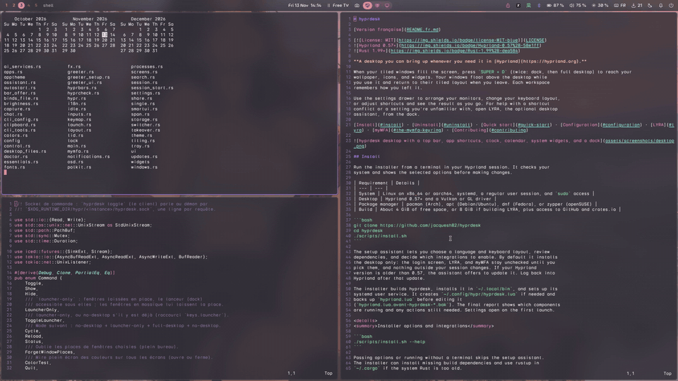

When your tiled windows fill the screen, press `SUPER + D` (twice: dock, then full desktop) to reach your
wallpaper, icons, and widgets. Your windows float above the desktop while
you use it and return to their tiled layout when you leave. Each workspace
remembers how you left it.

Use the settings drawer to arrange your monitors, change your keyboard layout,
or adjust shortcuts and see the result as you go. For help with a shortcut
conflict or a setting you’re unfamiliar with, open LYRA, the optional desktop
assistant, from the dock.

[What it replaces](#what-hyprdesk-replaces) · [Install](#install) · [Uninstall](#uninstall) · [Quick start](#quick-start) · [Configuration](#configuration) · [LYRA](#lyra) · [myMFA](#the-mymfa-keyring) · [Contributing](#contributing)

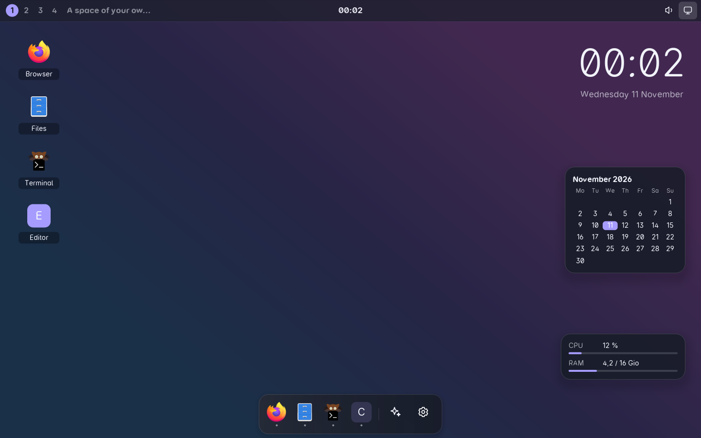

## What hyprdesk replaces

hyprdesk takes over the parts of a session that usually need a tool of their
own. The Hyprland configuration page reports anything left running, and LYRA
can tidy it with you.

**Replaced** — hyprdesk does the work:

- **Wallpaper** (`hyprpaper`): drawn natively per workspace and screen, with
  slideshows and crossfades; the installer can remove hyprpaper from
  autostart.
- **Login screen** (`GDM`, `SDDM`, `LightDM`): an optional greeter under
  greetd and cage takes over at the next boot; `sudo hyprdesk greeter setup
  restore` switches back to the previous one.
- **Lock screen** (`hyprlock`): a native ext-session-lock-v1 screen with PAM
  and optional fingerprint; the SUPER + L binding is rewritten to
  `hyprdesk lock`.
- **Secret Service** (`gnome-keyring`): with myMFA, its daemon serves the
  Secret Service — hyprdesk imports gnome-keyring secrets, masks its units,
  and one click gives them back.
- **Screen colours** (`wlsunset`, `gammastep`, `redshift`): brightness,
  contrast and gamma per screen through gamma tables; `hyprdesk colors free`
  stops — and can disable — a program still holding them.
- **Monitor arrangement** (written to `monitors.lua`): position, rotation,
  scale, primary and hotplug, applied live; an existing `monitors.lua` is
  taken over, not overwritten.

**Built in, with cohabitation** — hyprdesk provides the service and only
takes it if nobody else holds it: the notification daemon (`mako`, `dunst`…
stay in charge if they run), the polkit agent (an already-registered one
keeps the session), and the tray's StatusNotifierWatcher.

**Orchestrated** — the external tool stays, hyprdesk drives it: `hypridle`
(config written and supervised), `cliphist` + `wl-clipboard` (the clipboard
history behind `:clip`), `hyprsunset` (night light), `hyprshot` and
`wf-recorder` (screenshots, recording). The bar, dock and launcher are native
too: the Hyprland configuration page reports duplicate bars (waybar, ags,
eww), and an existing launcher binding is taken over.

## Install

Run the installer from a terminal in your Hyprland session. It checks your
system and shows the selected options before making changes.

| Requirement | Details |
| --- | --- |
| System | Linux on x86_64 or aarch64, systemd, a regular user session, and `sudo` access |
| Desktop | Hyprland 0.57+ and a Vulkan or GL driver |
| Package manager | pacman (Arch), apt (Debian/Ubuntu), dnf (Fedora), or zypper (openSUSE) |
| Build | About 4 GiB of free space, or 8 GiB if building LYRA, plus access to GitHub and crates.io |

```bash
git clone https://github.com/jacquesh82/hyprdesk
cd hyprdesk
./scripts/install.sh
```

The setup assistant lets you choose a language and keyboard layout, review
dependencies, and decide which integrations to enable. By default it installs
the desktop only: the login screen, LYRA, and myMFA stay unchecked until you
pick them, and nothing outside your session changes. If your Hyprland
version is older than 0.57, the assistant offers to update it. Log back into
Hyprland after that update.

The installer builds hyprdesk, installs it in `~/.local/bin`, and sets up its
systemd user service. It creates `~/.config/hypr/hyprdesk.lua` if needed and
backs up `hyprland.lua` before editing it
(`hyprland.lua.avant-hyprdesk-*.bak`). The final report shows which components
are running and any actions still needed. Settings open on the first launch.

<details>
<summary>Installer options and integrations</summary>

```bash
./scripts/install.sh --help
```

Passing options or running without a terminal skips the setup assistant.
The installer can install missing build dependencies and use rustup in
`~/.cargo` if the system Rust is too old.

| Option | What it controls |
| --- | --- |
| `--defaults` | Use the default choices without the setup assistant |
| `--lang fr\|en\|auto` | Choose the interface and installer language |
| `--keyboard fr:azerty` | Set the session keyboard using `layout[:variant[:options]]` |
| `--system-keyboard` | Apply the same layout system-wide |
| `--greeter` / `--no-greeter` | Replace your display manager with the greetd login screen, which uses cage (off unless asked) |
| `--optional-deps ask\|all\|none` | Choose how to handle optional dependencies |
| `--lyra` / `--no-lyra` | Install the LYRA assistant, or not (off unless asked; kept if already installed) |
| `--mymfa` / `--no-mymfa` | Install the myMFA keyring, its Secret Service integration, and PAM module, or not (off unless asked; kept if already installed) |
| `--no-hyprbars` | Skip the Hyprbars title-bar plugin |
| `--no-deps` | Manage prerequisites yourself. Check them with `scripts/deps.sh --dry-run` |
| `--no-autostart` | Skip the Hyprland startup entry |
| `--no-lock-key` | Skip the `SUPER + L` lock shortcut |
| `--remove-hyprpaper` | Remove hyprpaper from autostart |
| `--verbose` | Show full command output in the terminal |

- **LYRA** is built from [mindlog.hyprland_tools](https://github.com/jacquesh82/mindlog.hyprland_tools). Set `HYPRDESK_LYRA_SRC` to use a local checkout or `HYPRDESK_LYRA_REF` to select the branch.
- **myMFA** provides a keyring for passwords and 2FA codes. Set `HYPRDESK_MYMFA_SRC` to use a local checkout of [mindlog.mymfa.clients](https://github.com/lelabnet-creator/mindlog.mymfa.clients). If the installer cannot access the repository, it logs the reason and continues.
- **Hyprbars** adds minimize, maximize, and close buttons in full desktop mode. The installer builds it with `hyprpm` against the running Hyprland version. The updater rebuilds it when that version changes.

Set `HYPRDESK_INSTALLER_TUI=0` to use terminal prompts in place of whiptail.
`NO_COLOR=1` or `HYPRDESK_COLOR=0` disables color, and `HYPRDESK_ASCII=1`
selects ASCII icons.

</details>

### Uninstall

```bash
./scripts/uninstall.sh --dry-run   # see what would change, touch nothing
./scripts/uninstall.sh             # summary, confirmation, then uninstall
```

The script restores your previous login screen if hyprdesk replaced it,
removes the service, binary, and font, and takes its lines out of
`hyprland.lua` and `binds.lua`: `SUPER + L` goes back to hyprlock, and the
services hyprdesk had taken over (polkit agent, hyprpaper…) start again. Each
edited file is backed up first (`*.avant-desinstallation-hyprdesk.bak`), and
the edit is rolled back if Hyprland reports a new error. Your configuration
stays for a later install unless you pass `--purge`; `--lyra` and `--mymfa`
also remove LYRA and myMFA.

## Quick start

| Shortcut | Action |
| --- | --- |
| `SUPER + D` | Next mode: hidden → dock (windows stay in place) → full desktop (windows float above the wallpaper, icons, and widgets) → hidden |
| `SUPER + ALT + D` | Toggle the dock and keep windows in place |
| `SUPER + CTRL + D` | Hide the desktop and dock |
| `SUPER + SHIFT + D` | Open Settings |
| `SUPER + R` | Search apps in any mode. Use `:clip` to search clipboard history |
| `ALT + Tab` | Switch windows |
| `SUPER + Tab` | Open the window overview with hyprexpo, Hyprspace, or hyprdesk’s own switcher |
| `SUPER + Escape` | Emergency exit |

Desktop modes are saved per workspace across sessions. With multiple monitors,
each screen follows the workspace it displays. Use **Settings → Desktop →
Forced modes** to set a mode for a specific screen or workspace. Windows you
move or resize in full desktop mode keep their positions for that application
and workspace. Clear those positions in **Settings → Desktop**.

**Settings → Shortcuts** and `hyprdesk keys` show every active binding, outside
the full desktop and with the desktop shown, with its source line in
`hyprland.lua`. hyprdesk respects existing bindings unless you assign them to
hyprdesk or leave its default `SUPER + R` override enabled. Where
`hyprland.lua` lacks an essential window, workspace or screen shortcut
(workspaces 1 to 10, previous workspace, maximize, pin, swap, group tabs,
next screen…), hyprdesk sets it on a free combination, without editing the
file; each one can be turned off in **Settings → Shortcuts → Windows and
workspaces**. Every hyprdesk shortcut and adjustable essential can be changed
by pressing the new combination (**Capture**) and set back with **Default**.

At startup, hyprdesk moves the `hl.bind` lines of `hyprland.lua` (with the
comments above them and the locals they use, such as `mainMod`) into
`binds.lua`, next to it, which `hyprland.lua` loads with `require("binds")`.
A copy is kept (`hyprland.lua.avant-hyprdesk-binds.bak`), and everything is
put back if Hyprland reports a new error. `binds.lua` stays yours; hyprdesk
only appends shortcuts that later appear in `hyprland.lua`. Preview with
`hyprdesk binds`.

<details>
<summary>Keyboard navigation in the dock</summary>

Open the dock in launcher-only mode or press Tab from the full desktop to
focus it. Use the arrow keys, Tab, and Shift + Tab to move between items, Home
and End to jump to either end, and Enter or Space to activate an item. Escape
closes the dock or returns focus to the full desktop.

</details>

## What you can do

- **Make the desktop yours.** Set wallpapers and slideshows per screen or
  workspace, add app and file shortcuts, and build a theme from an image. Drag
  modules to rearrange the bar, or use the dock to group windows by app.
- **Tune Hyprland from Settings.** Arrange monitors, set keyboard and touchpad
  options, pick a layout per workspace (Dwindle, Master, Scrolling, or Monocle),
  and adjust animations, shortcuts, and idle delays. Display layout changes
  revert after 12 seconds unless you keep them.
- **Set up your session.** Configure autostart, laptop lid behavior, the lock
  screen with fingerprint support, notifications, screenshots, and screen
  recording. The installer also offers a greetd login screen and a
  [myMFA keyring](#the-mymfa-keyring).
- **Add widgets in Lua.** Start with the clock, calendar, system stats, or media
  player, then add your own widgets and bar modules as Lua files.

| Monitor settings | Widgets |
| --- | --- |
| 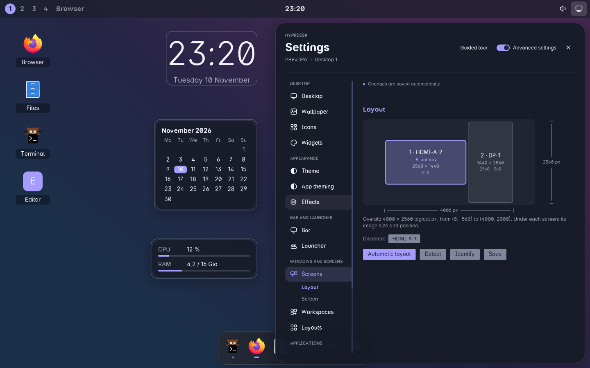 | 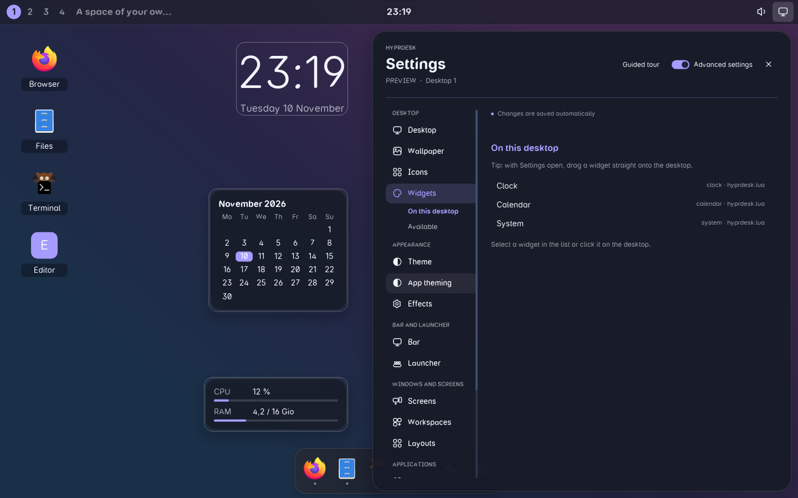 |

<details>
<summary>More screenshots</summary>

| Desktop and dock | Settings and appearance |
| --- | --- |
| 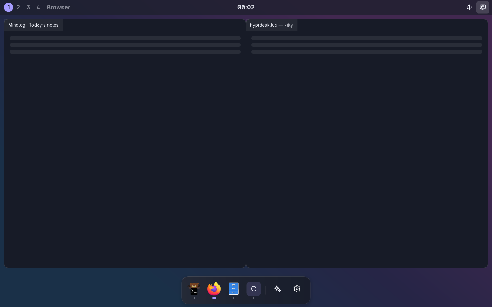 | 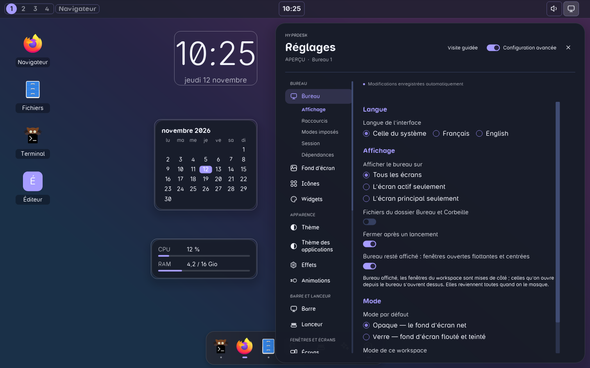 |
| 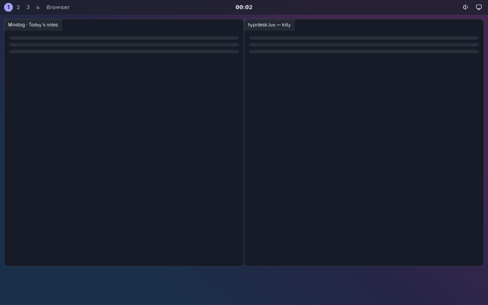 | 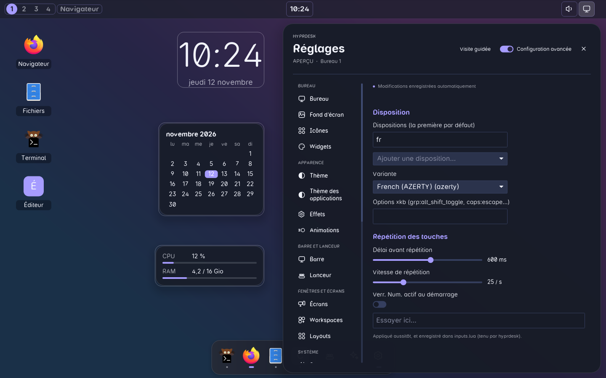 |
| 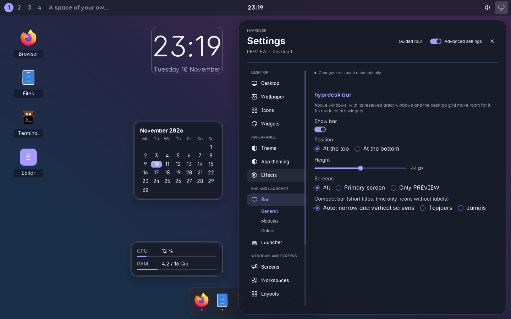 | 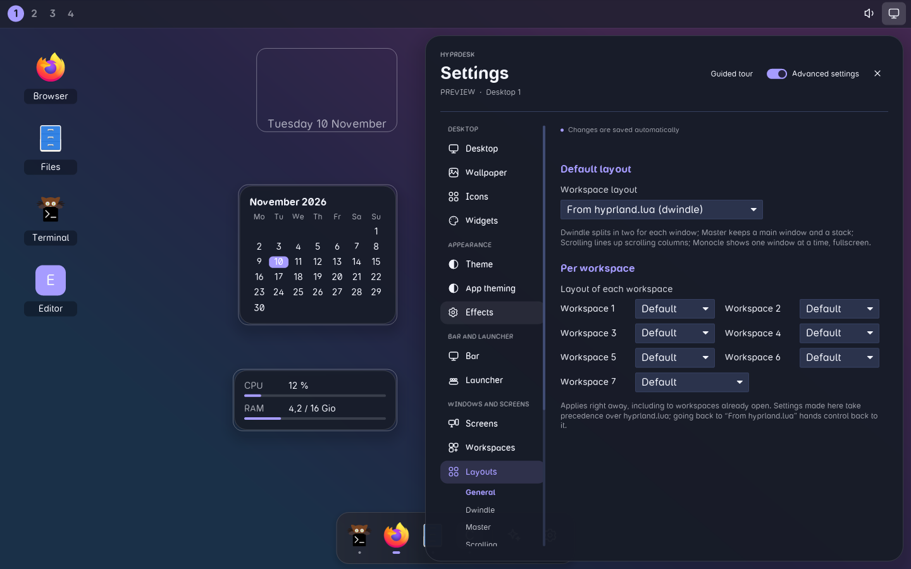 |
| 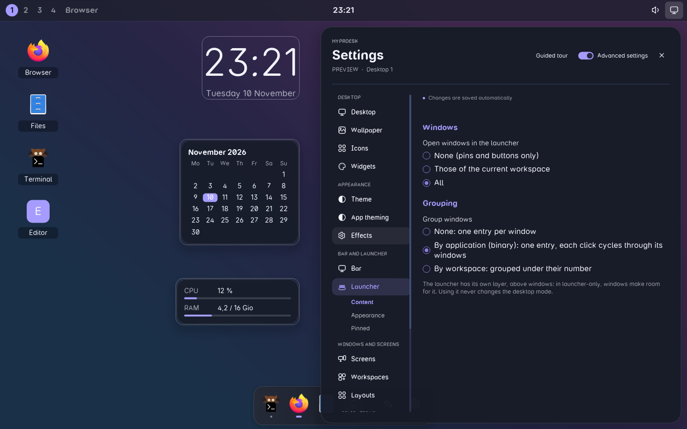 | 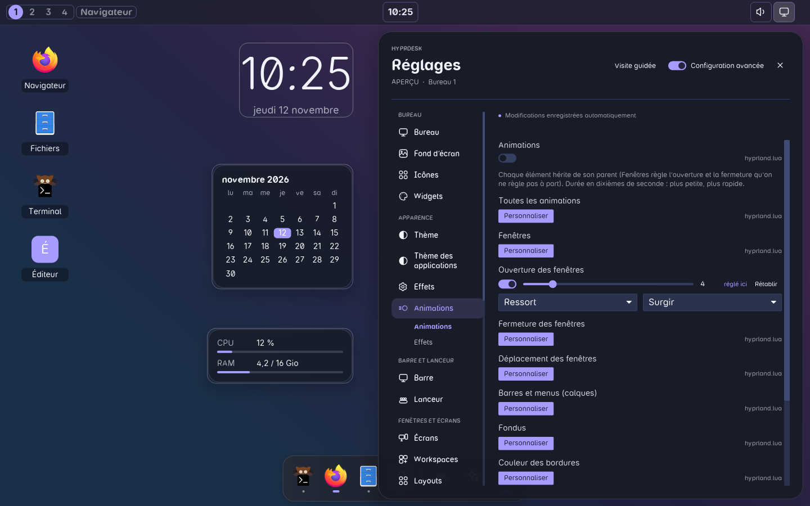 |
| 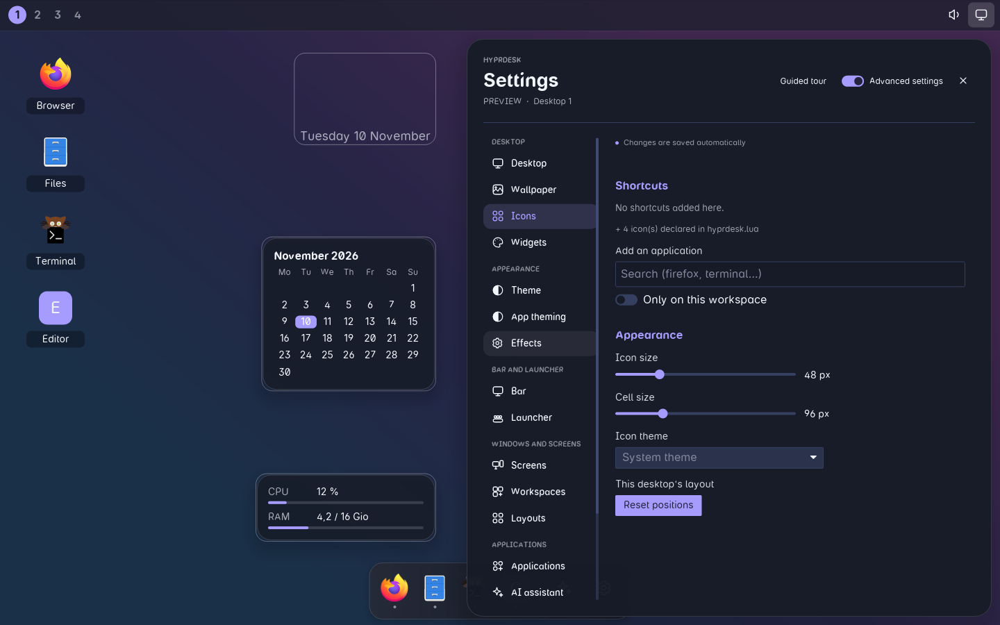 | 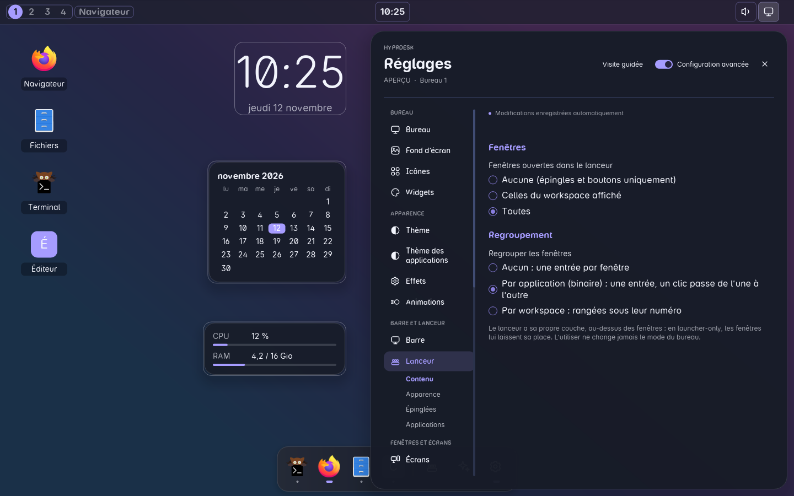 |
| 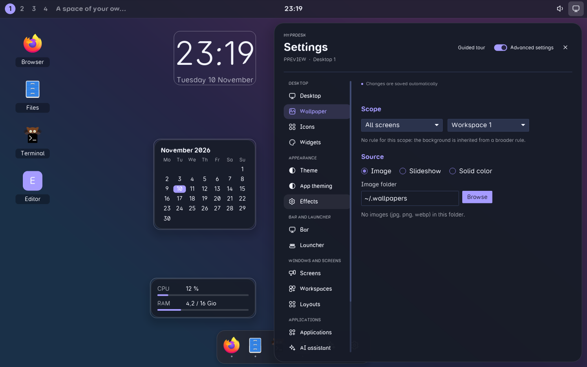 | 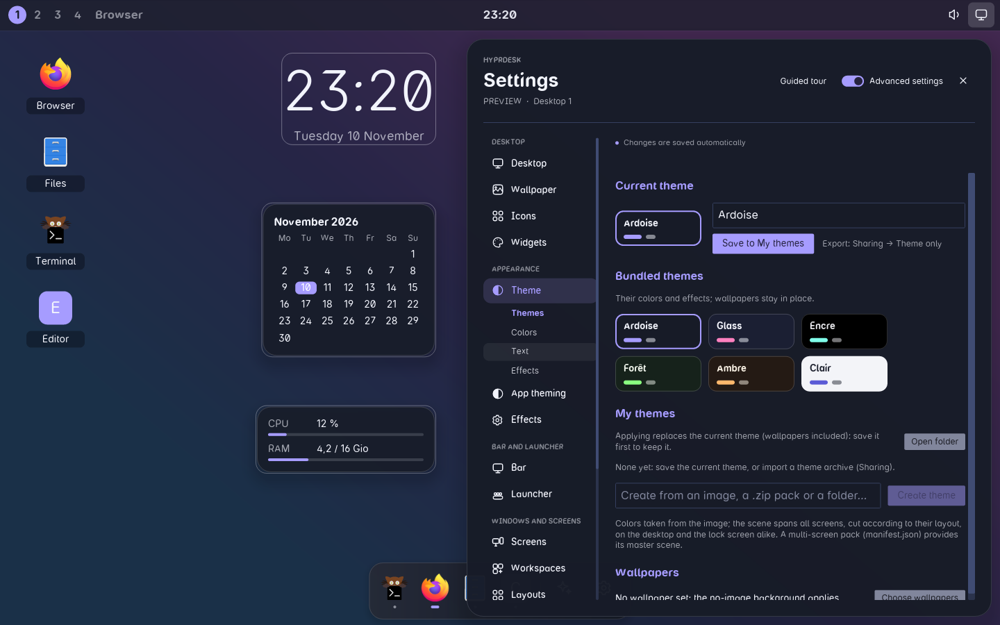 |
| 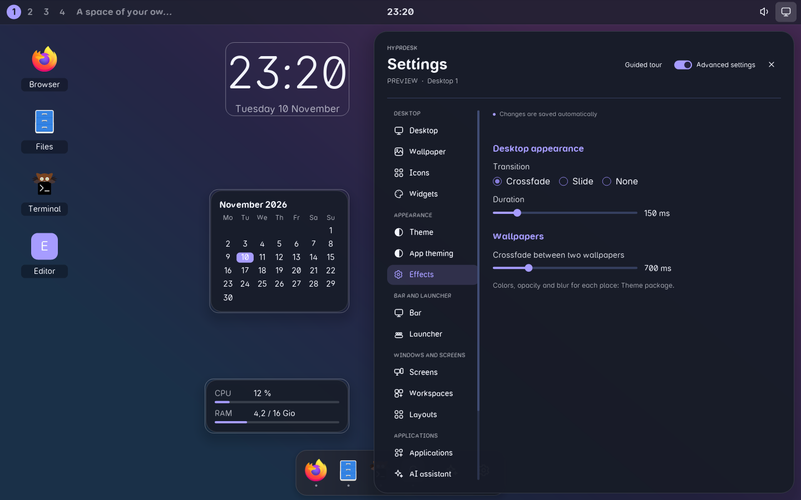 | 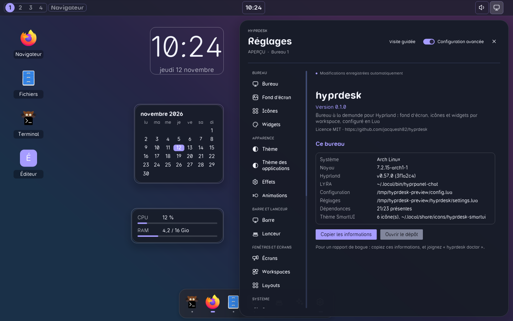 |

</details>

## Configuration

Open Settings from the dock or run `hyprdesk settings screens` to go straight
to the monitor page. Changes in the drawer apply live and save automatically to
`settings.lua`. Enable **Advanced configuration** in the header to see more
pages.

For a setup you can keep in your dotfiles, edit `~/.config/hypr/hyprdesk.lua`.

```lua
hd.wallpaper({ path = "~/.wallpapers/default.jpg" })
hd.bar({ left = { "workspaces", "window" }, right = { "tray", "volume", "session" } })
hd.icon({ app = "firefox" })
hd.widget("clock", { anchor = "top-right", format = "%H:%M" })
```

Your Lua configuration takes precedence over settings saved by the drawer.
Both files reload when saved. If a configuration contains an error, hyprdesk
reports the file and line and keeps using the last working configuration.
See the [configuration reference](docs/ADVANCED.md#configuration-reference).

<details>
<summary>Session controls and recovery</summary>

- **Autostart** lists programs managed by hyprdesk, eligible entries in the
  `hl.on("hyprland.start", …)` block of `hyprland.lua`, and XDG autostart
  entries. hyprdesk-managed entries go in `autostart.lua`, loaded with
  `require("autostart")`. Use **Run** to try a command.
- **Screen colours** adjusts brightness, contrast, gamma, and individual color
  channels. It accepts ArgyllCMS `.cal` curves and passes `.icc` or `.icm`
  profiles to Hyprland via `monitors.lua`. Run `hyprdesk color-test` for a full-screen test
  pattern or `hyprdesk colors diag` to diagnose gamma-table conflicts. The
  settings page can stop a program holding the gamma tables, with a separate
  option to also disable its user service or XDG autostart entry.
- **Laptop lid** lets you choose what happens on battery, on AC power, or with
  an external monitor attached. Available actions include using the system
  default, suspending, hibernating, locking, turning off the laptop display,
  or ignoring the lid event. hyprdesk locks before suspending.
- **Hyprland configuration** flags errors, duplicate bindings or startup
  entries, and programs that overlap with built-in services. **Tidy
  everything** backs up `hyprland.lua` and applies the fixes marked safe.
- **Restore the default configuration** in **Settings → About**, or run
  `hyprdesk config reset --yes`, to restore the sample `hyprdesk.lua` and clear
  the settings saved in the drawer. Both files are backed up under
  `~/.config/hypr/hyprdesk/sauvegardes/<date>/`. Hyprland files, themes, and
  widgets are outside the scope of the reset.

</details>

## LYRA

Open LYRA from the dock or run `hyprdesk assistant`. The assistant can explain a
setting or help work through an issue using context from your session, such as
your monitors, workspaces, shortcuts, and apps. Run `hyprdesk context` to see
what hyprdesk provides to LYRA.

When LYRA proposes a command or a change, you can review and approve it in the
drawer. Some changes include a live preview that you can accept or discard.
**Ask LYRA** buttons open a conversation with the relevant details already
filled in. Scripts can do the same with `hyprdesk ask <title> <text>`.

Choose Claude Code, Codex, or Zcode in **Settings → AI → Assistant**. LYRA uses
your existing CLI subscription. You can also select providers for other AI
features in **Settings → AI → Other AI services**, including Anthropic, OpenAI,
Z.ai, and OpenAI-compatible endpoints such as Ollama. API keys for those
providers are stored in the session keyring.

**SmartUI design** redraws app icons in a consistent style. Approved icons form
the `hyprdesk-smartui` icon theme under `~/.local/share/icons`, used across the
desktop, dock, app launcher, bar, and notifications. Automatic generation is
enabled by default when LYRA is installed.

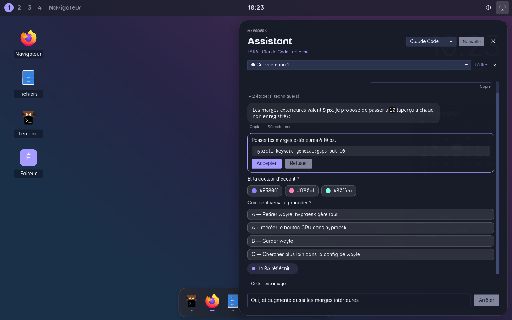

<details>
<summary>AI settings screenshots</summary>

| Assistant | Other AI services | SmartUI design |
| --- | --- | --- |
| 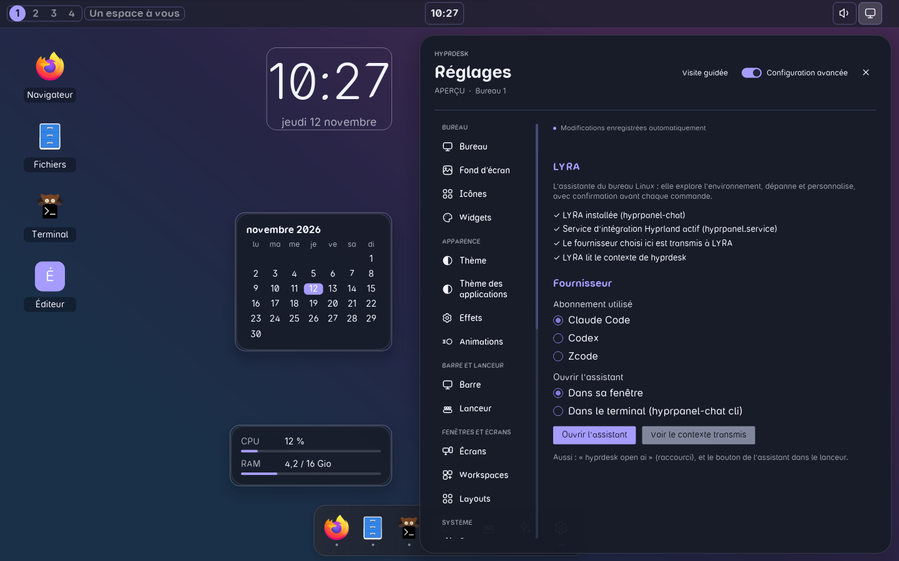 | 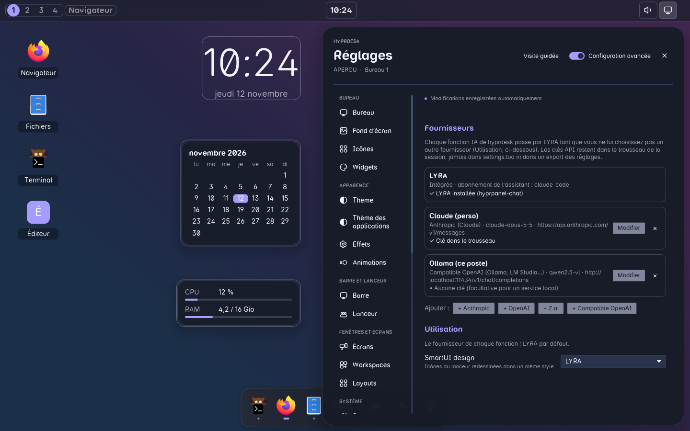 | 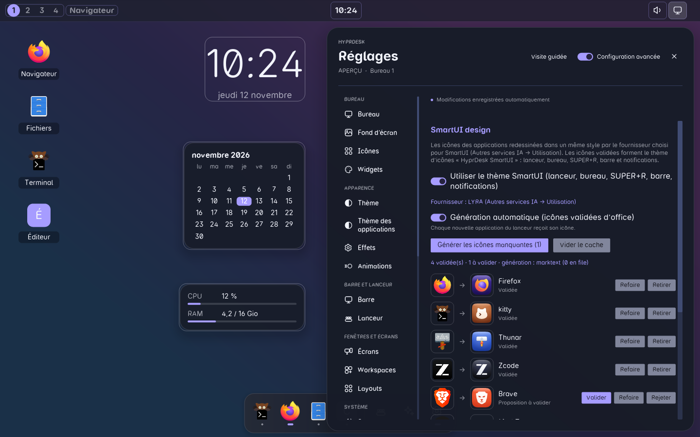 |

</details>

## The myMFA keyring

myMFA is an optional keyring for passwords and 2FA codes. Installed with
hyprdesk from its [public repository](https://github.com/lelabnet-creator/mindlog.mymfa.clients)
when you ask for it (`--mymfa`, or checked in the setup assistant), its daemon serves the Secret Service — the secrets
your applications keep go to the myMFA vault — and the `pam_mymfa` module
can open that vault when you log in. hyprdesk is its interface:

- **The myMFA window** (`hyprdesk mymfa window`) shows the 2FA codes, the
  passwords, the vault’s dashboard and activity, this device, its settings,
  and a scanner that adds an account from a QR image or a screenshot. The
  bar’s `mymfa` module shows the vault’s state, and an unlock card in
  hyprdesk’s own style answers applications asking for the vault.
- **The launcher** finds codes and passwords with `:2fa` and `:mdp`. The
  daemon itself does the copying, and a copied password clears from the
  clipboard after 30 seconds.
- **Settings → Passwords** creates the vault, or installs the backup of the
  [myMFA web app](https://app.mymfa.mindlog.today). It can also take the
  Secret Service over from gnome-keyring — importing its secrets, then
  stopping it — with one button to go back.
- The **Device** tab links this machine’s vault to the web app’s, merges
  the two, and shows the synchronization journal.

## Widgets and plugins

Enable widgets in **Settings → Widgets** or add them to your Lua configuration.
The built-in widgets are `clock`, `calendar`, `system`, `media` (MPRIS),
`command` (periodic shell output), and `lua` (output of an inline function).
Desktop widgets default to the primary screen. You can target a specific
output or all outputs and choose whether a widget moves or hides when a
screen is unplugged.

```lua
hd.widget("clock", { screen = "DP-2", if_missing = "primary" })
hd.widget("calendar", { screen = "DP-2", if_missing = "hide" })
```

The bar includes `workspaces`, `window`, `volume`, `brightness`, `tray`,
and `desktop`. To add a Lua widget or plugin, see [Writing a plugin](docs/WRITING_PLUGINS.md).

<details>
<summary>Bundled plugins and their dependencies</summary>

| Plugin | What it does | Relies on |
| --- | --- | --- |
| `reseau` | Wired and wireless networks, VPN, WireGuard, airplane mode | NetworkManager |
| `bluetooth` | Scan, pair, and manage devices | bluetoothctl |
| `batterie` | Battery status, alerts, and power profiles | sysfs, power-profiles-daemon |
| `capture` | Screenshots and screen recording | hyprshot, wf-recorder |
| `clavier` | View and switch keyboard layouts | Hyprland |
| `lecteur` | Now playing and playback controls | MPRIS |
| `majs` | Pending updates and upgrades | pacman/AUR, apt, dnf, zypper, flatpak |
| `supports` | Open and eject removable drives | udisks2 |
| `nuit` | Night light on demand or on a schedule | hyprsunset |
| `vkbd` | On-screen keyboard | wvkbd |
| `notifications` | Recent notifications and Do Not Disturb | hyprdesk or wayle |
| `session` | Lock, suspend, log out, reboot, and power off | systemd, hyprdesk lock |

The installer places two editable examples, `meteo` and `notes`, in
`~/.config/hypr/hyprdesk/widgets/`.

</details>

## Command line

| Command | Use it to |
| --- | --- |
| `hyprdesk show` / `hyprdesk launcher-only` / `hyprdesk hide` | Set the workspace’s desktop mode |
| `hyprdesk settings [package]` | Open Settings or jump to a page |
| `hyprdesk theme new <image>` | Build a theme from an image |
| `hyprdesk wallpaper split <image>` | Split a scene across your monitors |
| `hyprdesk export [file]` / `hyprdesk import <archive>` | Share or restore a setup. Add `--theme` for just the theme or `--screens` to include display settings |
| `hyprdesk check [file]` | Validate a Lua configuration without touching the running daemon |
| `hyprdesk status` / `hyprdesk doctor` | Inspect the current state or diagnose missing dependencies |
| `hyprdesk --help` | See the complete command list and options |

## Update and troubleshoot

From the cloned repository, run `./scripts/update.sh` to review and apply
updates. The updater reuses your installer options and stops if the checkout
has local changes. Use `--check` for the report alone (exit code `10` means
an update is available), or `--yes` to apply without prompting.

- **Install failed.** See `~/.local/state/hyprdesk/install-<date>.log` for the
  failed step and its full output, then rerun the installer after addressing it.
- **hyprdesk won’t start.** Run `journalctl --user -u hyprdesk -n 50` and
  `hyprdesk doctor`.
- **myMFA is missing.** Check **Settings → Passwords** and the install log for
  the cause. If the installer cannot access the myMFA repository, rerun it with
  `HYPRDESK_MYMFA_SRC` pointing to a local checkout.
- **Hyprbars is missing.** From a terminal inside Hyprland, run
  `hyprpm update`, then
  `hyprpm add https://github.com/hyprwm/hyprland-plugins`.
- **Restore the previous login screen.** Run `sudo hyprdesk greeter setup restore`.

## Contributing

For a bug report, include what you expected, what happened, and the shortest
way to reproduce it. **Settings → About** can copy the hyprdesk, system,
Hyprland, and LYRA version information for your report. [Open an issue](https://github.com/jacquesh82/hyprdesk/issues).

Use **Rust 1.99 or newer** and keep builds locked to `Cargo.lock`. The lockfile
pins `winit-core` to `0.31.0-beta.2` for compatibility with the UI stack.

```bash
cargo test --locked
bash scripts/verify.sh
cargo run --locked -- preview
```

The verification script runs formatting checks, strict Clippy, tests, a build,
and isolated D-Bus checks. Add `--visual` to capture the demo views at 1440,
900, and 640 px under `/tmp/hyprdesk-visual` by default. The interactive preview
uses demo data and leaves session settings untouched. Check compositor blur and
multi-monitor behavior in a Hyprland session.

See the [development guide](docs/ADVANCED.md#development) for more build and
verification details, and the [contributing guide](CONTRIBUTING.md) for the
pull request workflow.

## Documentation

- [Advanced guide](docs/ADVANCED.md)
- [Writing a plugin](docs/WRITING_PLUGINS.md)
- [Plugin, widget, and launcher internals](docs/PLUGINS.en.md)
- [Changelog](CHANGELOG.md)
- [Contributing guide](CONTRIBUTING.md)

## Credits and license

hyprdesk is released under the [MIT license](LICENSE).

- [Hyprland](https://hyprland.org), the compositor hyprdesk lives in;
- [iced](https://github.com/iced-rs/iced), the GUI toolkit — with patched
  copies of [exwlshelleventloop](https://github.com/waycrate/exwlshelleventloop)'s
  `layershellev` and `iced_layershell` under `vendor/` (MIT);
- the [Mindlog typeface](https://github.com/jacquesh82/mindlog.fonts),
  bundled under the [SIL Open Font License 1.1](assets/fonts/mindlog/OFL.txt);
- [mindlog.hyprland_tools](https://github.com/jacquesh82/mindlog.hyprland_tools),
  home of LYRA and of the `hyprpanel-core` Hyprland IPC library;
- the myMFA keyring, from
  [mindlog.mymfa.clients](https://github.com/lelabnet-creator/mindlog.mymfa.clients).

The full dependency list lives in `Cargo.lock`.
