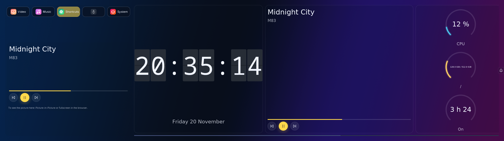
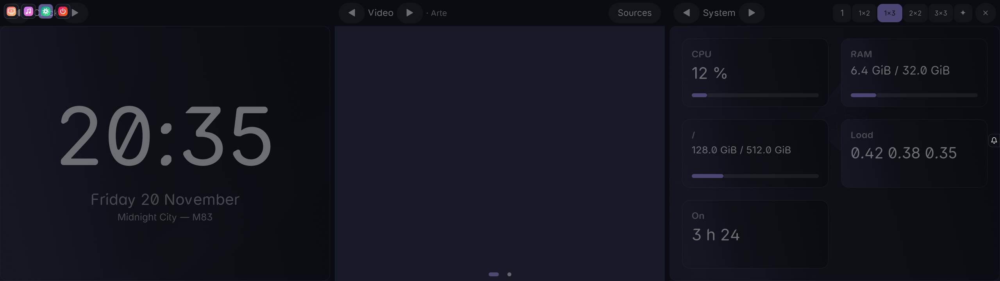
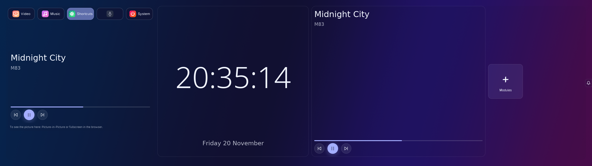
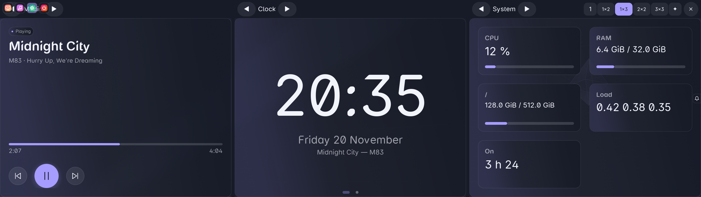
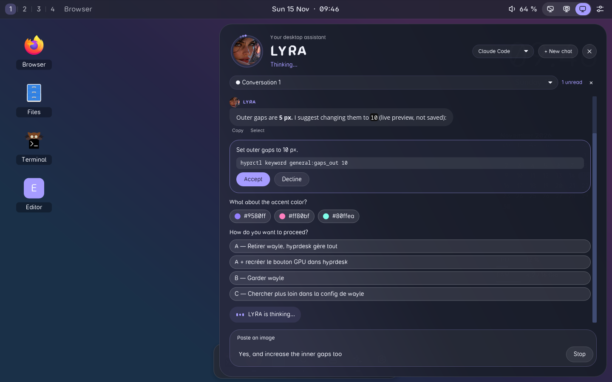
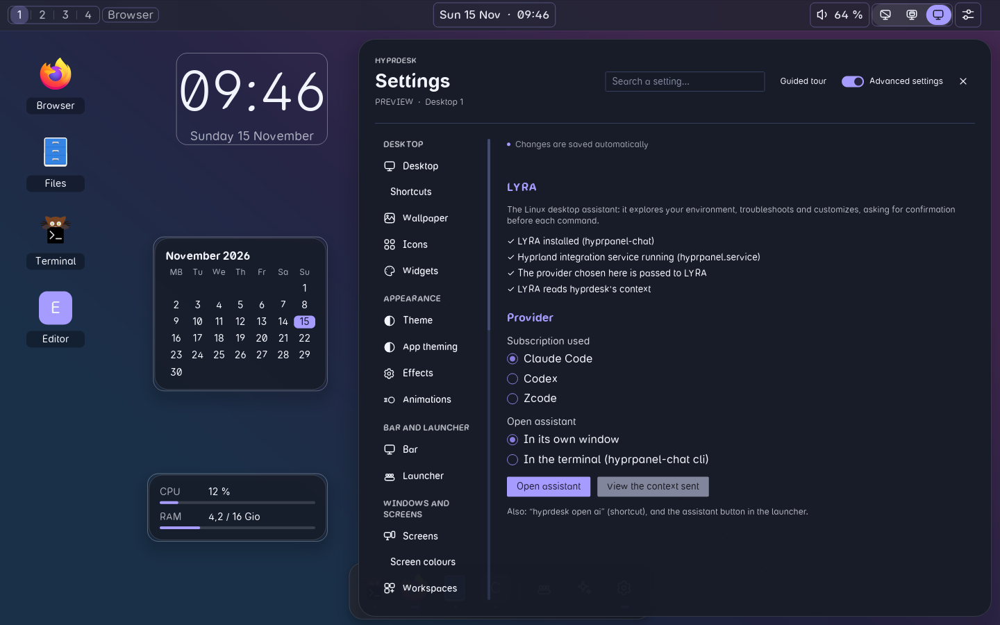
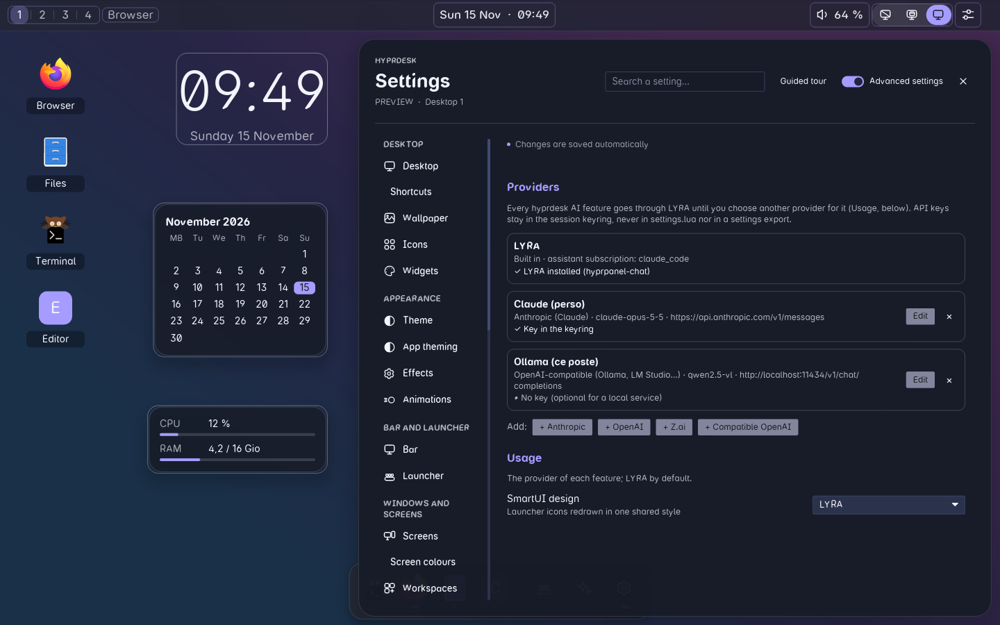
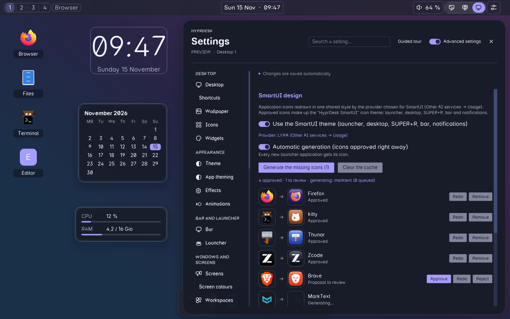

# Guide d'utilisation de hyprdesk

[English version](GUIDE.md) · [Retour au README](../README.fr.md)

Ce guide détaille chaque fonction de hyprdesk. Pour l'architecture et la
liste complète des clés de configuration, voir le
[guide avancé](ADVANCED.md) (en anglais).

- [Installation en détail](#installation-en-détail)
- [Désinstaller et tout restaurer](#désinstaller-et-tout-restaurer)
- [Ce que hyprdesk remplace](#ce-que-hyprdesk-remplace)
- [Le bureau et ses modes](#le-bureau-et-ses-modes)
- [Raccourcis et binds.lua](#raccourcis-et-bindslua)
- [Régler Hyprland depuis les Réglages](#régler-hyprland-depuis-les-réglages)
- [Contrôles de session et récupération](#contrôles-de-session-et-récupération)
- [Recherche de fichiers](#recherche-de-fichiers)
- [Panorama](#panorama)
- [LYRA et SmartUI](#lyra-et-smartui)
- [Le trousseau myMFA](#le-trousseau-mymfa)
- [Widgets et plugins](#widgets-et-plugins)
- [Dépannage](#dépannage)

## Installation en détail

Deux chemins : le **paquet de la dernière release** (recommandé, aucun
compilateur pour hyprdesk), ou **compiler le dépôt en l'état** avec
`scripts/install_nightly_build.sh` (le dernier commit, ou votre arbre de
travail modifié).

`scripts/install.sh` télécharge le paquet de la release et l'installe avec
votre gestionnaire de paquets. Installation manuelle :
`apt install ./hyprdesk_*.deb`, `dnf install hyprdesk-*.rpm` ou
`pacman -U hyprdesk-*.pkg.tar.zst`. Toutes les versions sont sur la
[page des releases](https://github.com/jacquesh82/hyprdesk/releases).

L'assistant propose la langue et le clavier, passe en revue les dépendances et
demande quelles intégrations activer. Par défaut, il n'installe que le bureau :
l'écran de connexion, LYRA et myMFA restent décochés tant que vous ne les
choisissez pas, et rien ne change hors de votre session. Si Hyprland est plus
ancien que 0.57, l'assistant propose de le mettre à jour ; reconnectez-vous
ensuite à Hyprland.

Le paquet installe ses binaires dans `/usr/bin` ; `--from-source` les
compile dans `~/.local/bin`. À côté de `hyprdesk` (le démon et ses
commandes), trois binaires dédiés s'occupent de l'authentification :
`hyprdesk-lock` (verrouillage), `hyprdesk-greeter` (écran de connexion) et
`hyprdesk-polkit` (agent polkit). Chacun ne contient que son propre code (ni
démon, ni Lua, ni index de fichiers), et `hyprdesk lock`, `hyprdesk greeter`
et `hyprdesk polkit-ui` leur passent la main.

Le script met aussi en place le service systemd utilisateur. Il crée
`~/.config/hypr/hyprdesk.lua` s'il manque et sauvegarde `hyprland.lua`
avant d'y toucher (`hyprland.lua.avant-hyprdesk-*.bak`). Le bilan final
montre les composants en marche et ce qu'il reste à faire.

Au premier démarrage, un assistant de configuration visuel passe en revue
l'essentiel : langue, écrans, clavier, thème et fond d'écran, barre, bureau,
performance, veille, applications par défaut. Chaque choix s'applique
aussitôt. Il se rouvre par le bouton **Assistant** des Réglages ou
`hyprdesk wizard`.

### Options d'installation

```bash
./scripts/install.sh --help
```

Avec des options, ou sans terminal, l'assistant est sauté. L'installateur
peut installer les dépendances de construction qui manquent et utiliser rustup
dans `~/.cargo` si la Rust du système est trop ancienne.

| Option | Ce qu'elle contrôle |
| --- | --- |
| `--defaults` | choix par défaut, sans assistant |
| `--lang fr\|en\|auto` | langue de l'interface et de l'installateur |
| `--keyboard fr:azerty` | clavier de la session, `disposition[:variante[:options]]` |
| `--system-keyboard` | applique la même disposition à tout le système |
| `--greeter` / `--no-greeter` | remplace le gestionnaire de connexion par l'écran greetd, qui utilise cage (non, sauf demandé) |
| `--optional-deps ask\|all\|none` | comment traiter les dépendances facultatives |
| `--lyra` / `--no-lyra` | installe l'assistante LYRA, ou non (non, sauf demandée ; gardée si déjà là) |
| `--mymfa` / `--no-mymfa` | installe le trousseau myMFA, l'intégration Secret Service et le module PAM, ou non (non, sauf demandé ; gardé si déjà là) |
| `--no-hyprbars` | passe le plugin de barres de titre Hyprbars |
| `--fingerprint` / `--no-fingerprint` | lecteur d'empreintes détecté (par défaut : oui) : installe fprintd, déverrouille au doigt, propose d'enregistrer un doigt |
| `--from-source` | compile hyprdesk depuis ce dépôt au lieu d'installer la release (ce que fait `scripts/install_nightly_build.sh`) |
| `--no-deps` | gérez les prérequis vous-même ; `scripts/deps.sh --dry-run` les vérifie |
| `--no-autostart` | passe l'entrée de démarrage de Hyprland |
| `--no-lock-key` | passe le raccourci de verrouillage `SUPER + L` |
| `--remove-hyprpaper` | retire hyprpaper du démarrage automatique |
| `--verbose` | sortie complète des commandes au terminal |

### Intégrations

- **LYRA** est compilée depuis [mindlog.hyprland_tools](https://github.com/jacquesh82/mindlog.hyprland_tools). L'installateur compile la release publiée avec cette version de hyprdesk ([`scripts/versions.sh`](../scripts/versions.sh)). `HYPRDESK_LYRA_SRC` pointe vers une copie locale, `HYPRDESK_LYRA_REF` choisit un autre tag ou une branche (`main` suit le développement).
- **myMFA** est un trousseau pour mots de passe et codes 2FA. `HYPRDESK_MYMFA_SRC` pointe vers une copie locale de [mindlog.mymfa.clients](https://github.com/lelabnet-creator/mindlog.mymfa.clients), `HYPRDESK_MYMFA_REF` choisit un autre tag ou une branche que la release du client Linux de `scripts/versions.sh`. Si l'installateur n'atteint pas le dépôt, il en note la raison au journal et continue.
- **Hyprbars** ajoute les boutons réduire, agrandir et fermer en bureau complet. L'installateur le compile avec `hyprpm` contre le Hyprland qui tourne ; la mise à jour le recompile quand cette version change.

`HYPRDESK_INSTALLER_TUI=0` remplace whiptail par des questions au terminal.
`NO_COLOR=1` ou `HYPRDESK_COLOR=0` coupe les couleurs, et `HYPRDESK_ASCII=1`
choisit les icônes ASCII.

### Mettre à jour

Depuis le dépôt cloné, `./scripts/update.sh` relève puis applique les mises à
jour. Le script réutilise les options de votre installation et s'arrête si le
dossier contient des modifications locales. `--check` ne donne que le relevé
(code de sortie `10` : mise à jour disponible), `--yes` applique sans
question.

## Désinstaller et tout restaurer

```bash
./scripts/uninstall.sh --dry-run   # ce qui changerait, sans rien toucher
./scripts/uninstall.sh             # récapitulatif, confirmation, puis désinstallation
./scripts/uninstall.sh --restore   # tout remettre exactement comme avant hyprdesk
```

**Essayer hyprdesk est sans conséquence.** Avant toute modification,
`install.sh` garde une fois pour toutes l'état d'origine dans
`~/.local/state/hyprdesk/origine/`. Cela couvre les fichiers qu'il peut
toucher : `~/.config/hypr`, kitty, GTK, applications par défaut, services
utilisateur activés, masqués ou lancés. Cela couvre aussi les fichiers
système (écran de connexion, PAM, clavier, polkit, GPU) et les paquets
qu'il installe. `--restore` remet le tout. Ce qui est apparu depuis est
rangé dans `~/hyprdesk-avant-restauration-<date>/`, jamais effacé. Les
paquets installés pour hyprdesk sont proposés au retrait
(`--remove-packages` : sans question). Une mise à jour de Hyprland faite à
l'installation n'est pas défaite.

Une désinstallation simple rend l'écran de connexion d'avant si hyprdesk
l'avait remplacé, et retire le service, les binaires et la police. Elle ôte
les lignes de hyprdesk de `hyprland.lua` et `binds.lua` : `SUPER + L`
revient à hyprlock. Les services que hyprdesk avait pris en charge (agent
polkit, hyprpaper…) repartent. Chaque fichier modifié est d'abord copié
(`*.avant-desinstallation-hyprdesk.bak`), et la modification est annulée si
Hyprland signale une nouvelle erreur. Votre configuration reste pour une
réinstallation, sauf avec `--purge` ; `--lyra` et `--mymfa` retirent aussi
LYRA et myMFA.

## Ce que hyprdesk remplace

hyprdesk prend en charge ce qui demandait, dans une session, un outil à lui
tout seul. La page Configuration de Hyprland signale ce qui reste en marche,
et LYRA peut le ranger avec vous.

**Remplacés** : hyprdesk fait le travail.

- **Fond d'écran** (`hyprpaper`) : dessiné nativement, par workspace et par
  écran, avec diaporamas et fondus ; l'installateur peut retirer hyprpaper de
  l'autostart. Une image ou une **vidéo en boucle** (mp4, webm…) par règle.
- **Écran de connexion** (`GDM`, `SDDM`, `LightDM`) : un greeter sous greetd
  et cage prend la place au prochain démarrage ; `sudo hyprdesk greeter
  setup restore` revient à l'écran d'avant. Fond image ou **vidéo en boucle**
  (rendue par mpv en GPU quand il est là, décodée par hyprdesk sinon), vidéo
  livrée par défaut, et formulaire placable en neuf points de l'écran.
- **Écran de verrouillage** (`hyprlock`) : verrouillage natif
  (ext-session-lock-v1) avec PAM et empreinte au besoin ; la liaison
  SUPER + L est réécrite vers `hyprdesk lock`. Il tourne dans son propre
  binaire (`hyprdesk-lock`) et sa propre scope systemd : redémarrer ou
  mettre à jour hyprdesk ne l'emporte jamais.
- **Secret Service** (`gnome-keyring`) : avec myMFA, son démon tient le
  Secret Service. hyprdesk importe les secrets de gnome-keyring, masque ses
  unités, et un clic les lui rend.
- **Couleurs des écrans** (`wlsunset`, `gammastep`, `redshift`) : luminosité,
  contraste et gamma par écran, par tables gamma ; `hyprdesk colors free`
  arrête (et peut désactiver) un programme qui les tient encore.
- **Disposition des écrans** (écrite dans `monitors.lua`) : position,
  rotation, échelle, écran principal et branchement à chaud, appliqués en
  direct ; un `monitors.lua` existant est repris, pas écrasé.

**Fournis, en cohabitation** : hyprdesk ne prend le service que si personne
ne le tient. Cela vaut pour le démon de notifications (`mako`, `dunst`…
restent maîtres s'ils tournent), l'agent polkit (un agent déjà enregistré
garde la session) et le StatusNotifierWatcher de la zone de notification.

**Orchestrés** : l'outil externe reste, hyprdesk le pilote. Cela vaut pour
`hypridle` (configuration écrite et supervisée), `cliphist` + `wl-clipboard`
(l'historique derrière `:clip`), `hyprsunset` (éclairage nocturne),
`hyprshot` et `wf-recorder` (captures, enregistrement). La barre, le dock et
le lanceur sont natifs aussi. La page Configuration de Hyprland signale les
barres en double (waybar, ags, eww), et une liaison de lanceur existante est
reprise.

## Le bureau et ses modes

En tuiles, les fenêtres couvrent l'écran : `SUPER + D` (deux fois : le dock,
puis le bureau complet) ramène le fond d'écran, les icônes et les widgets.
Les fenêtres passent en flottant par-dessus le bureau le temps de
l'utiliser, et retrouvent leur mosaïque quand vous le quittez.

Le mode du bureau est mémorisé par workspace, d'une session à l'autre. Avec
plusieurs écrans, chacun suit le workspace qu'il affiche. **Réglages → Bureau →
Modes imposés** fixe le mode d'un écran ou d'un workspace précis. Une fenêtre
déplacée ou redimensionnée en bureau complet garde sa place, par application
et par workspace ; « Oublier ces places » les efface (**Réglages → Bureau**).

**Navigation au clavier dans le dock.** Ouvrez le dock en mode lanceur seul,
ou par Tab depuis le bureau complet, pour lui donner le clavier. Flèches, Tab
et Maj + Tab changent de case, Début et Fin vont aux bouts, Entrée ou Espace
activent une case. Échap referme le dock ou rend le clavier au bureau
complet.

## Raccourcis et binds.lua

**Réglages → Raccourcis** et `hyprdesk keys` montrent toutes les liaisons
actives, hors plein bureau et bureau affiché, avec leur ligne d'origine dans
`hyprland.lua`. hyprdesk respecte les liaisons en place, sauf celles que vous
lui confiez et son `SUPER + R` par défaut, que l'on peut désactiver.

Là où `hyprland.lua` n'a pas un raccourci essentiel, hyprdesk le pose sur une
combinaison libre, sans modifier le fichier. Les essentiels couvrent
fenêtres, workspaces, écrans et captures : workspaces 1 à 10, workspace
précédent, maximiser, épingler, échanger, onglets de groupe, écran suivant,
captures par `Impr`… Chacun se coupe dans **Réglages → Raccourcis → Fenêtres
et workspaces**. Pour changer un raccourci de hyprdesk ou un essentiel
réglable, cliquez sur **Capturer** puis appuyez sur la nouvelle
combinaison ; **Par défaut** rend sa valeur d'origine.

Au démarrage, hyprdesk range les lignes `hl.bind` de `hyprland.lua` dans
`binds.lua`, à côté, que `hyprland.lua` charge par `require("binds")`. Les
commentaires qui les annoncent et les locales dont elles se servent, comme
`mainMod`, suivent. Une copie est gardée
(`hyprland.lua.avant-hyprdesk-binds.bak`), et tout est remis en place si
Hyprland signale une nouvelle erreur.

`binds.lua` est tenu par hyprdesk. Chaque changement fait dans Réglages →
Raccourcis le régénère d'après ce qu'il définit vraiment : variables
remplacées par leur valeur, boucles dépliées, un raccourci par ligne. Vos
commentaires de section et les raccourcis désactivés sont gardés. Un
fichier écrit à la main est d'abord copié
(`binds.lua.avant-hyprdesk-binds.bak`). Aperçu : `hyprdesk binds generate` ;
application : `hyprdesk binds generate --write`.

## Régler Hyprland depuis les Réglages

- **Faites le bureau vôtre.** Fonds d'écran et diaporamas par écran ou par
  workspace, raccourcis d'applications et de fichiers, thème tiré d'une
  image. Les modules de la barre se réorganisent au glisser, le dock
  regroupe les fenêtres par application. Le thème des applications porte le
  thème jusqu'à kitty et Thunar.
- **Écrans et saisie.** Disposez les écrans, réglez clavier et pavé
  tactile. Un changement de disposition des écrans revient seul au bout de
  12 secondes si vous ne le gardez pas.
- **Layouts et zones.** Choisissez un layout par workspace (Dwindle, Master,
  Scrolling ou Monocle). **Réglages → Écrans → Zones** découpe un écran en
  1×2, 1×3, 2×2 ou 3×3. Chaque fenêtre reste dans sa zone, et maximiser ne
  couvre que cette zone. `SUPER + CTRL + SHIFT + flèche` envoie une fenêtre
  dans la zone voisine.
- **Apparence et comportement.** Animations, bordures, marges, règles de
  fenêtres, groupes, curseur, gestes du pavé tactile (doigts et sens →
  workspace, déplacer, redimensionner, plein écran…), environnement et
  délais de veille. hyprdesk les écrit dans des fichiers générés chargés
  par `hyprland.lua`.
- **Configuration avancée** (interrupteur en tête des Réglages) : ce qui ne
  sert qu'à l'expert, marqué en cyan — un point à côté du paquet ou de
  l'onglet, une pastille « Avancé » en tête de page, un cadre cyan autour
  des sections avancées. On y trouve les courbes d'animation, les
  transitions du bureau, le comportement et les groupes de fenêtres, les
  règles de couches et de workspaces, les réglages par périphérique
  (vitesse, accélération, défilement, disposition d'un seul clavier ou
  d'une seule souris), les variables d'environnement, les **plugins
  Hyprland** (hyprpm : activer ou couper chaque plugin, mettre à jour,
  ajouter un dépôt, recharger au démarrage) et les **permissions**
  (autoriser, refuser ou demander pour la capture d'écran, le chargement de
  plugins et les claviers, les conseillées en un clic).
- **Performance.** Un profil de rendu (Performance, Équilibré ou Rendu
  graphique) échange les effets contre la charge du processeur et de la
  carte graphique. **Réglages → Performance → Carte graphique** montre la
  carte sur laquelle Hyprland dessine et prévient quand vos écrans sont
  branchés sur une autre. Il peut fixer Hyprland sur une carte
  (`hyprland_gpu`). hyprdesk dessine sur la même carte par défaut ; son
  moteur de rendu et ses fils d'exécution se règlent au même endroit.

### Styles de barre

La barre propose deux styles. Continuité conserve sa barre Unix et son dock
flottant séparé. `style = "graphite"` intègre le lanceur dans une barre des
tâches rectangulaire en bas (48 pixels logiques, sans marge) : Démarrer,
Recherche, Vue des tâches et applications sont centrés sur l'écran ; les
widgets sont à droite par défaut, avec heure et date sur deux lignes. Les
modules peuvent être ajoutés ou glissés à gauche, au centre ou à droite, dans
la barre comme dans Réglages → Barre → Modules. Les épingles et actions du
lanceur sont partagées ; aucun second dock flottant n'est créé sur ces
écrans.

## Contrôles de session et récupération

- **Démarrage automatique** liste les programmes supervisés par hyprdesk, les
  entrées éligibles du bloc `hl.on("hyprland.start", …)` de `hyprland.lua`,
  et les entrées XDG. Les programmes de hyprdesk vont dans `autostart.lua`,
  chargé par `require("autostart")`. « Lancer » essaie une commande.
- **Couleurs des écrans** règle luminosité, contraste, gamma et chaque canal.
  Il accepte les courbes `.cal` (ArgyllCMS) et confie les profils `.icc` ou
  `.icm` à Hyprland via `monitors.lua`. `hyprdesk color-test` affiche la mire
  plein écran, `hyprdesk colors diag` diagnostique les conflits de tables
  gamma. La page peut arrêter un programme qui les tient, avec une option
  séparée pour désactiver aussi son service utilisateur ou son entrée de
  démarrage automatique.
- **Capot du portable** choisit ce qui se passe sur batterie, sur secteur, ou
  avec un écran externe branché : comme le système, mise en veille,
  hibernation, verrouillage, extinction de l'écran du portable, ou rien.
  hyprdesk verrouille avant de mettre en veille.
- **Verrouillage** règle l'écran de verrouillage, et enregistre ou supprime
  vos empreintes avec fprintd sans quitter hyprdesk.
- **Configuration de Hyprland** signale les erreurs, les liaisons ou démarrages
  en double, et les programmes qui font doublon avec les services intégrés.
  « Tout ranger » sauvegarde `hyprland.lua` et applique les corrections sûres.
  Son onglet **Historique** garde 30 jours d'instantanés de la configuration
  (un avant chaque modification, et après chaque modification à la main) et
  permet d'y revenir ; aussi `hyprdesk config history`, `diff <id>` et
  `rollback <id|date> --yes`.

### Configuration par défaut

Chaque page des Réglages qui garde quelque chose dans hyprdesk a son bouton
**Par défaut…** (en haut à droite). En ligne de commande,
`hyprdesk config reset <composant>` montre l'aperçu, puis `--yes`
applique. Un composant revient à sa configuration par défaut : ses réglages
sont rendus à ceux du bureau de départ, et les fichiers de Hyprland qu'il
tient sont réécrits :

- Raccourcis : `binds.lua` sans raccourci coupé ;
- Clavier et souris : `inputs.lua` aux valeurs de Hyprland, disposition du
  clavier gardée ;
- Écrans : `monitors.lua` en mode préféré ;
- Démarrage automatique : `autostart.lua` vide.

Son état mémorisé est oublié : positions des icônes, modes de bureau, places
des fenêtres, lancements. Les autres composants ne bougent pas.

**Réglages → À propos** ou `hyprdesk config reset all --yes` font tout à la
fois. Ils effacent en plus les notifications gardées et mettent de côté les
thèmes et les widgets perso.

`hyprdesk.lua` n'est jamais touché : une clé qu'il fixe garde sa valeur, et
la remise le signale. Les fichiers remplacés sont copiés sous
`~/.config/hypr/hyprdesk/sauvegardes/<date>/`, et l'historique permet d'y
revenir. Le son, le réseau, l'énergie et les autres réglages du système
n'ont pas de configuration par défaut propre : hyprdesk n'en garde rien.

### Exporter et importer

`hyprdesk export [fichier]` et **Réglages → Partage** emballent un setup
entier dans une archive. Elle contient les réglages, plugins, thèmes et
l'état de hyprdesk ; `hyprland.lua`, chaque fichier local qu'il `require`
et les scripts que ces fichiers appellent ; et chaque image que les réglages
désignent. `hyprdesk import <archive>` le restaure. Les fichiers de Hyprland
importés sont vérifiés par Hyprland et comptent comme du code à accepter.
`monitors.lua` ne s'applique qu'avec `--screens`, et les chemins du dossier
personnel sont réécrits pour la nouvelle machine. `--theme` n'exporte que le
thème : couleurs, police, thème d'icônes, thème des applications et image du
verrouillage.

## Recherche de fichiers

La loupe du dock (ou `:f` dans le lanceur, ou `hyprdesk files`) cherche dans
un index de tous vos fichiers, home et volumes montés (NTFS, FAT…) compris,
par nom, chemin ou catégorie : réponse en quelques millisecondes. Filtrez par
nature (fichiers, dossiers, liens) et par catégorie (documents, images,
vidéos, programmes…).

L'index vit en arrière-plan, tenu à jour par inotify et un rescan
périodique. Il se règle dans **Réglages → Index de fichiers** : racines,
exclusions par nom ou par expression régulière, extensions et catégories à
ignorer, taille maximale par fichier. Au terminal :
`hyprdesk index query <mot>`, `index status` (JSON) et `index rebuild` ;
`--json` donne des résultats structurés.

## Panorama

Un écran très allongé (2560×720, 1920×480, 1280×400…, à l'horizontale ou à
la verticale), tactile ou non, devient un plein écran à pages qu'on fait
glisser au doigt ou à la souris. hyprdesk le propose de lui-même au
branchement d'un tel écran, y rattache le tactile, en retire la barre et ne
prend jamais le clavier aux fenêtres. Escamotez-le pour rendre l'écran aux
fenêtres.

- **Pas d'écran bandeau ?** **Réglages → Écrans → un écran → Définir une
  zone Panorama** réserve une bande (en haut, en bas, à gauche ou à droite,
  de 10 à 50 % de l'écran) sur un écran ordinaire ; les fenêtres s'arrêtent
  avant. Ou essayez-le en fenêtre flottante avec `hyprdesk panorama preview`.
- **Compositions.** Les compositions forest, telemetry, studio, applications
  et cinématique placent librement horloges, lecteur, jauges, graphiques,
  calendrier et raccourcis tactiles. Après la vue principale, le carrousel
  porte d'autres pages, chacune avec sa composition. Glisser vers le haut
  ouvre le choix de disposition, vers le bas escamote le Panorama.
- **Zones.** Le Panorama se découpe jusqu'à neuf zones (de 1×2 à 3×3),
  chacune avec son widget. Chaque disposition garde ses propres réglages.
- **Vidéo et musique.** Le widget Vidéo lit Free TV, Netflix, Disney+, HBO
  Max… dans sa zone, dans une fenêtre d'application du navigateur posée là
  et cadrée pour ne montrer que la vidéo. Seules les plateformes utilisables
  sont listées (sans compte, ou connecté). Le profil Musique ajoute les
  services de streaming et les webradios (favorites et annuaire Radio
  Browser), lues sans fenêtre derrière une barre « flux vocal ».
- **Incrustation (PiP).** Quand Panorama est affiché, il accueille les
  fenêtres PiP et les vidéos mises en plein écran depuis les autres écrans,
  une à la fois. Retirer la vidéo, ou quitter le plein écran, rend la
  fenêtre à son workspace avec sa place d'avant. Ce retour se coupe dans
  **Réglages → Panorama → Lecteur → Vidéo**.
- **Voile vidéo.** Pendant la lecture, un voile sombre se pose autour de la
  vidéo pour la détacher et reposer les yeux ; il s'atténue quand la souris
  passe sur le Panorama. Intensité, portée, pause, durée du fondu et
  atténuation sous la souris se règlent dans **Réglages → Panorama →
  Lecteur → Vidéo**.
- **Système.** Les tuiles de mesure (processeur, mémoire, GPU et VRAM via
  `nvidia-smi`, disque, températures) tracent des courbes fluides en
  direct. Toucher l'une d'elles ouvre un gestionnaire de tâches trié selon
  cette mesure.
- **Commandes.** Le sélecteur de disposition et le bouton d'escamotage sont
  masqués par défaut ; cochez **Afficher les commandes du bandeau** pour les
  voir sur le Panorama.

|  |  |
| --- | --- |
|  |  |

Tous les réglages sont dans **Réglages → Panorama**, `hyprdesk config set
panorama.*` et `hyprdesk panorama`. [Composer un bandeau Panorama](PANORAMA.md)
détaille modules, compositions et clés Lua.

## LYRA et SmartUI

Ouvrez LYRA depuis le dock, ou lancez `hyprdesk assistant`. L'assistante
explique un réglage ou aide à résoudre un problème avec le contexte de la
session : écrans, workspaces, raccourcis, applications. `hyprdesk context`
montre ce que hyprdesk lui fournit.

Quand LYRA propose une commande ou un changement, vous le relisez et
l'approuvez dans le tiroir. Certains changements viennent avec un aperçu en
direct, à accepter ou à rejeter. Des boutons « Demander à LYRA » ouvrent une
conversation déjà remplie des détails utiles ; les scripts font de même avec
`hyprdesk ask <titre> <texte>`.

Choisissez Claude Code, Codex ou Zcode dans **Réglages → IA → Assistant** :
LYRA passe par l'abonnement CLI que vous avez déjà. **Réglages → IA → Autres
services IA** choisit les fournisseurs des autres fonctions IA : Anthropic,
OpenAI, Z.ai, et tout endpoint compatible OpenAI comme Ollama. Les clés API
de ces fournisseurs restent dans le trousseau de la session.

**Voix.** Le bouton micro du Panorama active la voix de LYRA. hyprdesk
attend le mot « Lyra » (Vosk, hors ligne), transmet la demande, et lit la
réponse avec les voix locales de Piper, en français ou en anglais. Seules
les commandes à risque élevé sont confirmées à voix haute. Les modèles
s'installent au premier usage dans `~/.local/share/hyprdesk/voice`
(~350 Mo, sans root) ; voir `hyprdesk voice setup | say | status`.

Le **SmartUI design** redessine les icônes des applications dans un style
cohérent. Les icônes validées forment le thème `hyprdesk-smartui` sous
`~/.local/share/icons`, utilisé partout : bureau, dock, lanceur, barre et
notifications. La génération automatique est active par défaut quand LYRA est
installée.



| Assistant | Autres services IA | SmartUI design |
| --- | --- | --- |
|  |  |  |

## Le trousseau myMFA

myMFA est un trousseau facultatif de mots de passe et de codes 2FA. Il est
installé avec hyprdesk depuis son
[dépôt public](https://github.com/lelabnet-creator/mindlog.mymfa.clients)
quand vous le demandez (`--mymfa`, ou coché dans l'assistant). Son démon
tient le Secret Service : les secrets que vos applications confient vont au
coffre myMFA, et le module `pam_mymfa` peut ouvrir ce coffre à la connexion.
hyprdesk en est l'interface :

- **La fenêtre myMFA** (`hyprdesk mymfa window`) montre les codes 2FA, les
  mots de passe, le tableau de bord et l'activité du coffre, cet appareil,
  ses réglages, et un scanner qui ajoute un compte depuis un QR (image ou
  capture d'écran). Le module `mymfa` de la barre montre l'état du coffre,
  et une carte de déverrouillage au style de hyprdesk répond aux
  applications qui le réclament.
- **Le lanceur** trouve codes et mots de passe avec `:2fa` et `:mdp`. La
  copie est faite par le démon lui-même, et un mot de passe copié s'efface
  du presse-papiers au bout de 30 secondes.
- **Réglages → Mots de passe** crée le coffre, ou installe la sauvegarde de
  [l'application web myMFA](https://app.mymfa.mindlog.today). Il peut aussi
  reprendre le Secret Service de gnome-keyring (import de ses secrets, puis
  arrêt), avec un bouton pour revenir en arrière.
- L'onglet **Appareil** lie le coffre de cette machine à celui du web,
  fusionne les deux, et montre le journal de synchronisation.

## Widgets et plugins

Activez les widgets dans **Réglages → Widgets** ou ajoutez-les à votre
configuration Lua. Les widgets intégrés sont `clock`, `calendar`, `system`,
`media` (MPRIS), `command` (sortie périodique d'une commande), `lua` (sortie
d'une fonction en ligne) et `controls` (le centre de contrôle). Un widget du
bureau va sur l'écran principal par défaut ; on peut viser un écran précis,
ou tous, et choisir s'il déménage ou se masque quand l'écran est débranché.

```lua
hd.widget("clock", { screen = "DP-2", if_missing = "primary" })
hd.widget("calendar", { screen = "DP-2", if_missing = "hide" })
hd.widget("controls", {})
```

La barre propose `workspaces`, `window`, `volume`, `brightness`, `tray` et
`desktop`. Ajoutez n'importe quel widget dans **Réglages → Barre →
Modules**, ou dans une zone de `hd.bar`. Les modules qui débordent restent
accessibles dans **Autres commandes**. Pour ajouter un widget ou un plugin
en Lua : [Écrire un plugin](WRITING_PLUGINS.md) (en anglais).

| Plugin livré | Rôle | S'appuie sur |
| --- | --- | --- |
| `network` | Réseaux filaire et Wi-Fi, VPN, WireGuard, mode avion | NetworkManager |
| `bluetooth` | Recherche, appariement et gestion des appareils | bluetoothctl |
| `battery` | État des batteries, alertes et profils d'énergie | sysfs, power-profiles-daemon |
| `capture` | Captures d'écran et enregistrement | hyprshot, wf-recorder |
| `keyboard` | Voir et changer de disposition clavier | Hyprland |
| `player` | Morceau en cours et commandes de lecture | MPRIS |
| `updates` | Mises à jour en attente, progression en direct, un seul mot de passe par mise à jour (règle polkit facultative) | pacman/AUR, apt, dnf, zypper, flatpak |
| `removable` | Ouvrir et éjecter les disques amovibles | udisks2 |
| `nightlight` | Éclairage nocturne, à la demande ou selon un horaire | hyprsunset |
| `vkbd` | Clavier virtuel | wvkbd |
| `notifications` | Dernières notifications et Ne pas déranger | hyprdesk ou wayle |
| `session` | Verrouiller, mettre en veille, déconnecter, redémarrer, éteindre | systemd, verrouillage hyprdesk |
| `gpu` | Bascule à chaud une carte en passthrough entre VFIO et le pilote NVIDIA (masqué sans passthrough) | vfio-pci, nvidia |

L'installateur place deux exemples modifiables, `meteo` et `notes`, dans
`~/.config/hypr/hyprdesk/widgets/`.

## Dépannage

- **L'installation échoue.** Le journal `~/.local/state/hyprdesk/install-<date>.log`
  montre l'étape fautive et sa sortie complète ; corrigez, puis relancez.
- **hyprdesk ne démarre pas.** `journalctl --user -u hyprdesk -n 50`, puis
  `hyprdesk doctor`.
- **Une erreur de configuration.** hyprdesk signale le fichier et la ligne et
  garde la dernière configuration valide. `hyprdesk check [fichier]` vérifie
  un fichier sans toucher au démon.
- **myMFA est absent.** Vérifiez **Réglages → Mots de passe** et le journal
  d'installation. Si l'installateur n'atteint pas le dépôt myMFA, relancez-le
  avec `HYPRDESK_MYMFA_SRC` pointant vers une copie locale.
- **Hyprbars est absent.** Dans un terminal sous Hyprland :
  `hyprpm update`, puis
  `hyprpm add https://github.com/hyprwm/hyprland-plugins`.
- **Revenir à l'écran de connexion d'avant.** `sudo hyprdesk greeter setup restore`.
- **Tout défaire.** `./scripts/uninstall.sh --restore`.
