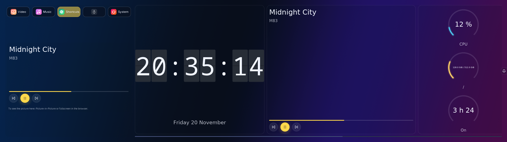
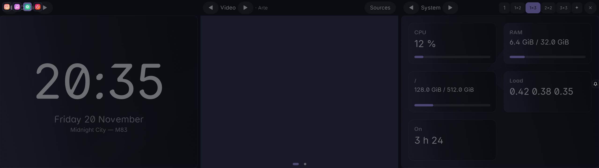
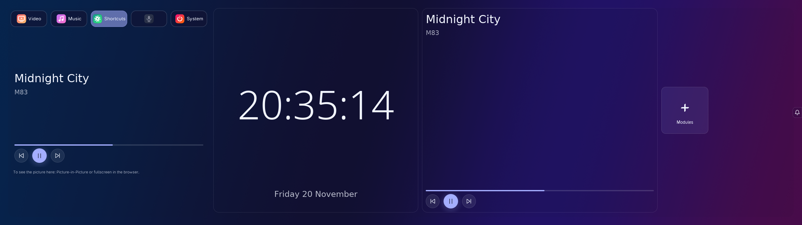
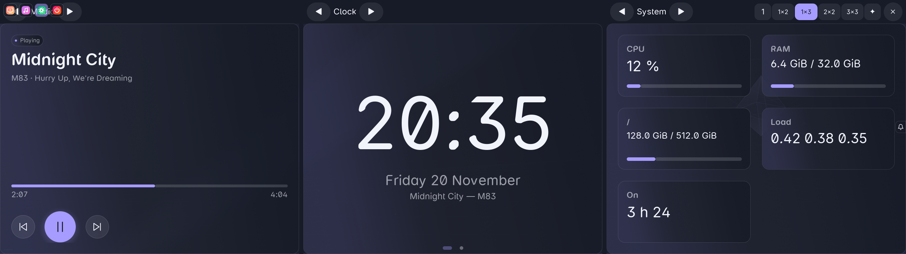
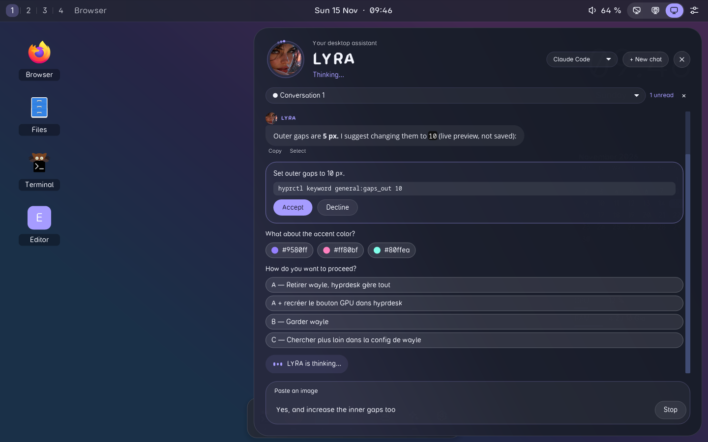
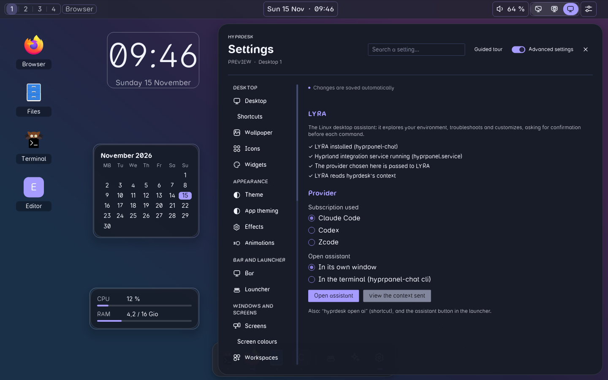
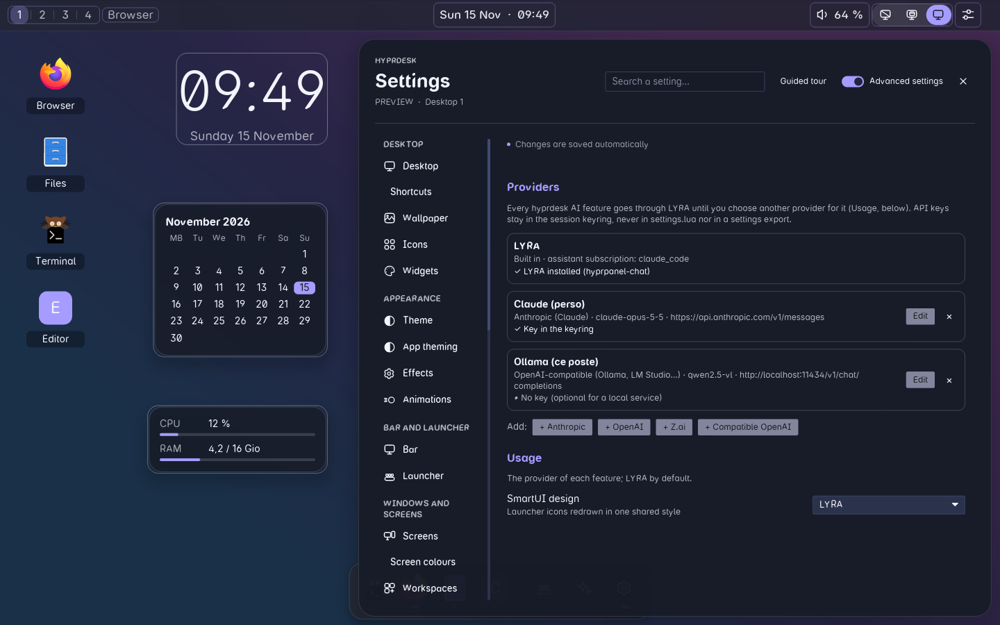
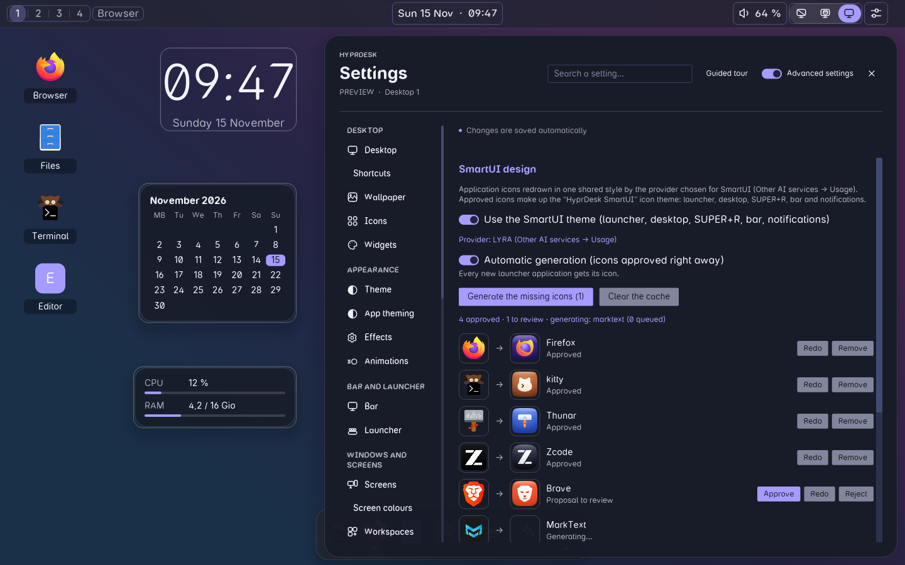

# hyprdesk user guide

[Version française](GUIDE.fr.md) · [Back to the README](../README.md)

This guide covers each hyprdesk feature in detail. For the architecture and
the full list of configuration keys, see the [advanced guide](ADVANCED.md).

- [Installation in detail](#installation-in-detail)
- [Uninstalling and restoring](#uninstalling-and-restoring)
- [What hyprdesk replaces](#what-hyprdesk-replaces)
- [The desktop and its modes](#the-desktop-and-its-modes)
- [Shortcuts and binds.lua](#shortcuts-and-bindslua)
- [Tuning Hyprland from Settings](#tuning-hyprland-from-settings)
- [Session controls and recovery](#session-controls-and-recovery)
- [File search](#file-search)
- [Panorama](#panorama)
- [LYRA and SmartUI](#lyra-and-smartui)
- [The myMFA keyring](#the-mymfa-keyring)
- [Widgets and plugins](#widgets-and-plugins)
- [Troubleshooting](#troubleshooting)

## Installation in detail

There are two ways to install. The **latest release package** is
recommended and needs no compiler for hyprdesk. You can also **build this
repository as it stands** with `scripts/install_nightly_build.sh`, which
takes the last commit or your modified working tree.

`scripts/install.sh` downloads the release package and installs it with
your package manager. For a manual install, use
`apt install ./hyprdesk_*.deb`, `dnf install hyprdesk-*.rpm`, or
`pacman -U hyprdesk-*.pkg.tar.zst`. Every version is on the
[releases page](https://github.com/jacquesh82/hyprdesk/releases).

The setup assistant lets you choose a language and keyboard layout, review
dependencies, and decide which integrations to enable. By default it installs
the desktop only: the login screen, LYRA, and myMFA stay unchecked until you
pick them, and nothing outside your session changes. If your Hyprland
version is older than 0.57, the assistant offers to update it. Log back into
Hyprland after that update.

The package installs its binaries in `/usr/bin`; `--from-source` builds them
into `~/.local/bin`. Besides `hyprdesk` (the daemon and its commands), three
dedicated binaries handle authentication: `hyprdesk-lock` (lock screen),
`hyprdesk-greeter` (login screen) and `hyprdesk-polkit` (polkit agent). Each
one only contains its own code (no daemon, no Lua, no file index), and
`hyprdesk lock`, `hyprdesk greeter` and `hyprdesk polkit-ui` hand over to
them.

The script also sets up the systemd user service. It creates
`~/.config/hypr/hyprdesk.lua` if needed and backs up `hyprland.lua` before
editing it (`hyprland.lua.avant-hyprdesk-*.bak`). The final report shows
which components are running and any actions still needed.

On the first launch, a visual setup wizard walks through the essentials:
language, screens, keyboard, and default apps. Each choice applies at once;
the Close button of its header, or Esc, leaves it at any step. Customization
waits: theme and wallpaper, bar, desktop, performance, and sleep keep their
defaults. The **Assistant** button of Settings or `hyprdesk wizard` reopen
the wizard with every step.

### Installer options

```bash
./scripts/install.sh --help
```

Passing options or running without a terminal skips the setup assistant.
The installer can install missing build dependencies and use rustup in
`~/.cargo` if the system Rust is too old.

| Option | What it controls |
| --- | --- |
| `--defaults` | Use the default choices without the setup assistant |
| `--lang fr\|en\|auto` | Choose the interface and installer language |
| `--keyboard fr:azerty` | Set the session keyboard using `layout[:variant[:options]]` |
| `--system-keyboard` | Apply the same layout system-wide |
| `--greeter` / `--no-greeter` | Replace your display manager with the greetd login screen, which uses cage (off unless asked) |
| `--optional-deps ask\|all\|none` | Choose how to handle optional dependencies |
| `--lyra` / `--no-lyra` | Install the LYRA assistant, or not (off unless asked; kept if already installed) |
| `--mymfa` / `--no-mymfa` | Install the myMFA keyring, its Secret Service integration, and PAM module, or not (off unless asked; kept if already installed) |
| `--no-hyprbars` | Skip the Hyprbars title-bar plugin |
| `--fingerprint` / `--no-fingerprint` | With a fingerprint reader detected (default: on): install fprintd, unlock with a finger, offer to enroll one |
| `--from-source` | Build hyprdesk from this repository instead of installing the release (what `scripts/install_nightly_build.sh` does) |
| `--no-deps` | Manage prerequisites yourself. Check them with `scripts/deps.sh --dry-run` |
| `--no-autostart` | Skip the Hyprland startup entry |
| `--no-lock-key` | Skip the `SUPER + L` lock shortcut |
| `--remove-hyprpaper` | Remove hyprpaper from autostart |
| `--verbose` | Show full command output in the terminal |

### Integrations

- **LYRA** is built from [mindlog.hyprland_tools](https://github.com/jacquesh82/mindlog.hyprland_tools). The installer builds the release that ships with this version of hyprdesk ([`scripts/versions.sh`](../scripts/versions.sh)). Set `HYPRDESK_LYRA_SRC` to use a local checkout or `HYPRDESK_LYRA_REF` to select another tag or branch (`main` follows development).
- **myMFA** provides a keyring for passwords and 2FA codes. Set `HYPRDESK_MYMFA_SRC` to use a local checkout of [mindlog.mymfa.clients](https://github.com/lelabnet-creator/mindlog.mymfa.clients) or `HYPRDESK_MYMFA_REF` to select another tag or branch than the Linux client release in `scripts/versions.sh`. If the installer cannot access the repository, it logs the reason and continues.
- **Hyprbars** adds minimize, maximize, and close buttons in full desktop mode. The installer builds it with `hyprpm` against the running Hyprland version. The updater rebuilds it when that version changes.

Set `HYPRDESK_INSTALLER_TUI=0` to use terminal prompts in place of whiptail.
`NO_COLOR=1` or `HYPRDESK_COLOR=0` disables color, and `HYPRDESK_ASCII=1`
selects ASCII icons.

### Updating

From the cloned repository, run `./scripts/update.sh` to review and apply
updates. The updater reuses your installer options and stops if the checkout
has local changes. Use `--check` for the report alone (exit code `10` means
an update is available), or `--yes` to apply without prompting.

## Uninstalling and restoring

```bash
./scripts/uninstall.sh --dry-run   # see what would change, touch nothing
./scripts/uninstall.sh             # summary, confirmation, then uninstall
./scripts/uninstall.sh --restore   # put everything back exactly as before hyprdesk
```

**Trying hyprdesk is risk-free.** Before changing anything, `install.sh`
saves the original state once, in `~/.local/state/hyprdesk/origine/`. That
covers the files it may touch: `~/.config/hypr`, kitty, GTK, default
applications, and user services that are enabled, masked, or running. It
also covers system files (login screen, PAM, keyboard, polkit, GPU) and the
packages it installs. `--restore` puts all of it back. Anything that
appeared since is moved to `~/hyprdesk-avant-restauration-<date>/`, never
deleted. Packages installed for hyprdesk are offered for removal
(`--remove-packages` skips the question). A Hyprland upgrade done at
install time is not rolled back.

A plain uninstall restores your previous login screen if hyprdesk replaced
it, and removes the service, binaries, and font. It takes hyprdesk's lines
out of `hyprland.lua` and `binds.lua`, so `SUPER + L` goes back to
hyprlock. Services hyprdesk had taken over (polkit agent, hyprpaper…)
start again. Each edited file is backed up first
(`*.avant-desinstallation-hyprdesk.bak`), and the edit is rolled back if
Hyprland reports a new error. Your configuration stays for a later install
unless you pass `--purge`; `--lyra` and `--mymfa` also remove LYRA and
myMFA.

## What hyprdesk replaces

hyprdesk takes over the parts of a session that usually need a tool of their
own. The Hyprland configuration page reports anything left running, and LYRA
can tidy it with you.

**Replaced**: hyprdesk does the work.

- **Wallpaper** (`hyprpaper`): drawn natively per workspace and screen, with
  slideshows and crossfades; the installer can remove hyprpaper from
  autostart. An image or a **looping video** (mp4, webm…) per rule.
- **Login screen** (`GDM`, `SDDM`, `LightDM`): an optional greeter under
  greetd and cage takes over at the next boot; `sudo hyprdesk greeter setup
  restore` switches back to the previous one. Image or **looping video**
  background (played by mpv on the GPU when present, decoded by hyprdesk
  otherwise), a bundled default video, and a login form placeable on nine
  screen anchors.
- **Lock screen** (`hyprlock`): a native ext-session-lock-v1 screen with PAM
  and optional fingerprint; the SUPER + L binding is rewritten to
  `hyprdesk lock`. It runs as its own binary (`hyprdesk-lock`) in its own
  systemd scope, so restarting or updating hyprdesk never takes it down.
- **Secret Service** (`gnome-keyring`): with myMFA, its daemon serves the
  Secret Service. hyprdesk imports gnome-keyring secrets, masks its units,
  and one click gives them back.
- **Screen colours** (`wlsunset`, `gammastep`, `redshift`): brightness,
  contrast and gamma per screen through gamma tables; `hyprdesk colors free`
  stops (and can disable) a program still holding them.
- **Monitor arrangement** (written to `monitors.lua`): position, rotation,
  scale, primary and hotplug, applied live; an existing `monitors.lua` is
  taken over, not overwritten.

**Built in, with cohabitation**: hyprdesk provides the service and only
takes it if nobody else holds it. This covers the notification daemon
(`mako`, `dunst`… stay in charge if they run), the polkit agent (an
already-registered one keeps the session), and the tray's
StatusNotifierWatcher.

When hyprdesk serves notifications, each one appears at the top right of the
active screen, in a card of the theme. A critical notification stays there
until it is closed; the others stay at least for the set duration (“Display
time”): an app can ask for longer, never for less. A low-urgency notification
shows no bubble and goes
straight to the history (the `notifications` widget), like every notification
under Do Not Disturb, except the critical one. An action or a dismissal its
application did not receive is reported by a Hyprland notification, with its
cause.

The history is read in the bar's Notifications card (the `notifications`
widget), the Notifications card of the Continuité control centre and Panorama's
right pane. It is grouped by application: one box per application, its name as
the heading, the most recent on top.

An action can declare itself destructive — erase, discard — by prefixing its
key with `destructive:` (`destructive:erase`, for example with `notify-send -A
"destructive:erase=Erase everything"`): the freedesktop specification defines
nothing here, this is the hyprdesk convention. Its button stands apart from
the others, in red like a destructive menu entry, and the application receives
the key as is when it is invoked.

Silence (Do not disturb) picks its end when it is turned on, from the Continuity
control center: one hour, until this evening (6 PM) or until turned off. It
turns itself off at its deadline, and its tile says until when ("Silence ·
until 18:00"). From the command line: `hyprdesk notifications dnd on
[1h|soir]`.

When Silence ends — at its deadline or when you turn it off — a hyprdesk bubble
sums up what it held: "3 notifications during Do Not Disturb", and "from 2
apps" when they come from several. A click on that bubble opens the
notifications list and closes it; with nothing held, nothing appears.

The first notification from an application asks, in its bubble, for the
permission to send you notifications: "Decline" or "Allow", above its content.
The bubble stays until you answer or close it; closed without an answer,
nothing is recorded and the next notification asks again. "Decline": nothing
more from that application, neither bubble nor history. Until the permission is
given, nothing enters the history.

Settings → Notifications (System group) takes these decisions back, application
by application: the "Allow" switch, once off, revokes the permission like a
decline; the delivery style says what becomes of a notification from the
application — "Banners" (the bubble goes away after its delay), "Alerts" (the
bubble stays until closed) or "None" (history only, no bubble). A critical
notification keeps its rules whatever the style. The page also clears the
history ("Clear history", to be confirmed).

The first critical notification from an application explains, in its bubble,
that it gets through Silence and stays until it is closed; its "Block during
Silence" button denies the bypass to that application: under Silence, its
critical notifications then go to the history alone. Closing the bubble without
blocking keeps the bypass. `hyprdesk config reset all --yes` forgets these
decisions.

Every notification kept in the history is **unread** until you open a list: the
Notifications card of the bar, the Continuity control center or the
notifications pane of Panorama. Their count sits in a small oval laid on the
clock of the bar, at its corner nearest the edge of the screen ("99+" beyond
99); the clock's tooltip gives the count. A low-urgency notification, or one
received under Silence without a bubble, counts; a transient notification does
not. Without a clock in the bar, the lists remain the source. The published
state (`$XDG_RUNTIME_DIR/hyprdesk-notifications.txt`) carries the count in its
`unread=N` line; `count=N` remains the length of the history.

With the `island` bar style, a living bubble replaces the clock in the central
pill. A click on the pill then opens the notification in full — its body and
its actions — with "All notifications" and "Calendar" at the foot of the card:
a critical bubble holds the pill until it is closed, so the clock's calendar
stays within reach. Without a living bubble, the click opens the calendar.

**Orchestrated**: the external tool stays and hyprdesk drives it. This
covers `hypridle` (config written and supervised), `cliphist` +
`wl-clipboard` (the clipboard history behind `:clip`), `hyprsunset` (night
light), `hyprshot` and `wf-recorder` (screenshots, recording). The bar,
dock, and launcher are native too. The Hyprland configuration page reports
duplicate bars (waybar, ags, eww), and an existing launcher binding is
taken over.

From the dock or the app grid, the chosen icon pulses until its window
opens. A refused launch or an application that cannot be found is reported at
once by a Hyprland notification. With no window at all after five seconds, a
quieter notification suggests launching the application again.

You can also drag an application from a file manager (its `.desktop` file)
onto the dock: the dock is outlined in the accent color, and the application
is pinned at the end of the dock when you drop it.

Removing an application from the dock, or an icon or a widget from the
desktop, shows an “Undo removal” bubble: while it is there, it puts the item
back in its place. It follows the notification timeout, and only exists when
hyprdesk shows notifications.

A file on the desktop takes the icon of its type from the icon theme. If
the theme has none, it takes the icon of the application that opens it,
with its extension (`MD`, `ZIP`…) in a capsule along the bottom.

## The desktop and its modes

When your tiled windows fill the screen, press `SUPER + D` twice (dock, then
full desktop) to reach your wallpaper, icons, and widgets. Your windows float
above the desktop while you use it and return to their tiled layout when you
leave.

A fullscreen window does not hide the dock for good: it tucks away at the
screen edge and appears over the window when the pointer touches that edge.
A window that is only maximized leaves it in place. The bar does the same:
in full screen it tucks away at its edge and comes back on hover, menus
included. A menu open when full screen starts or ends closes. A bar set to
the overlay layer stays visible.

Desktop modes are saved per workspace across sessions. With multiple monitors,
each screen follows the workspace it displays. Use **Settings → Desktop →
Forced modes** to set a mode for a specific screen or workspace. Windows you
move or resize in full desktop mode keep their positions for that application
and workspace. Clear those positions in **Settings → Desktop**.

**Keyboard navigation in the dock.** Open the dock in launcher-only mode or
press Tab from the full desktop to focus it. Use the arrow keys, Tab, and
Shift + Tab to move between items, Home and End to jump to either end, and
Enter or Space to activate an item. Escape closes the dock or returns focus
to the full desktop.

**Keyboard navigation in the control center.** Tab and Shift + Tab move from
one control to the next; Ctrl + Tab and Ctrl + Shift + Tab jump to the first
control of the next or previous group; Page Up and Page Down scroll the
cards.

**Control center toggles.** Wi-Fi, Bluetooth and the other toggles fade
from off to on; while a toggle is in progress, the control gently pulses
until the answer arrives. With the “None” transition (Settings → Animations
→ Desktop), the change is immediate and the control shows “In progress…”.
**Theme → Components → Quick settings → Compact controls** reduces Wi-Fi and
Bluetooth to their symbol: hovering shows the title and state, a click
toggles, and a right click (or the “›” button of the Continuity center) opens
the menu.

**The keyboard on every surface.** Four shortcuts put the keyboard on a
shell surface without closing anything or changing mode: `CTRL + F2` goes to
the bar of the active screen, `CTRL + F3` to the dock (hidden desktop: it
appears under the windows, which stay in place), `CTRL + F8` gives the
keyboard to the banners on screen, otherwise opens the notification center, `CTRL + F6` opens the Settings drawer and focuses its
first field. Pressed twice, the bar and the dock return the keyboard to the
windows; the center and the drawer, which stay open, keep it. A bar menu
opened from the keyboard selects its first entry: Up and Down, Tab and
Shift + Tab, Home and End move from one entry to the next, Right opens a
submenu and moves into it, Left moves back out, Enter or Space activate the
entry, Escape closes the menu; a screen reader announces the selected entry.
In the Help menu, the search field keeps the keyboard: Up and Down move to
its entries, Tab returns to the field.
In the drawer,
Tab and Shift + Tab never leave it: they go through its fields and the
commands of its header (Close, Guided tour, Assistant, clear the search),
which the focus ring points out and Enter or Space activate; a mouse click
removes the ring.

**Guided tour.** Each block of the tour ends with a try: a real gesture,
such as switching modes, opening the workspaces screen or the applications
grid (“Try it”, or your shortcut), or changing one of the settings shown in
the drawer behind. “Done” confirms it; “Next” is always available.

**Full Keyboard Access.** On by default, it lets Tab reach every control in
Settings, not only text fields. `CTRL + F1` toggles it anywhere (`hyprdesk
keyboard-access`) and the on-screen display announces “Full Keyboard Access:
on” or “off”; when off, Tab only goes to text fields. In the drawer, Tab also goes through
the page navigation and its tabs, and the content scrolls to the control it
reaches; Ctrl + Tab jumps from the navigation to the content and back. On a
slider, the arrow keys change the value by the setting's step, Enter opens its
field; on a pop-up list, they move to the next option without opening it. The setting lives in
**Settings → Keyboard and mouse → Keyboard** (`keyboard_access`), the shortcut
in **Settings → Shortcuts** (`keys.keyboard_access`).

**Notifications from the keyboard.** In the notification center, Tab and
Shift + Tab move from one card to the next without leaving the center: Enter
opens what the card announces (or its short menu when it leads nowhere), and
the ring also reaches “Close”, the actions and the footer links. With banners
on screen, `CTRL + F8` first gives them the keyboard: Tab goes through their
controls, Enter activates, Esc returns the keyboard to the windows; pressed
again, it returns it and opens the center. While you go through them, banners
do not expire; choosing an action or the last banner leaving also returns the
keyboard.

**Keyboard navigation in the bar.** The arrow keys, Tab and Shift + Tab move
from one activable module to the next: those a left click opens (menus, volume,
clock…). Enter or Space opens the chosen module; its menu takes the keyboard,
the bar gets it back when the menu closes; Escape returns it to the windows.

**Force an application to quit.** `ALT + SUPER + Escape` opens the "Force
Quit" dialog: one row per application — its icon, its name, its number of
windows —, the active application selected first (`hyprdesk force-quit` from
the command line). Up and Down arrows move between rows; Enter or the button
asks for confirmation — "Force “foot” to quit (3 windows)?" — and a second
Enter kills its windows; Escape or "Cancel" first steps back from the
confirmation, then closes the dialog. Under Hyprland, an application class
often gathers several processes: they are all killed, hence the number. The
shortcut is set in **Settings → Shortcuts** (`keys.force_quit`), in every
desktop mode.

### Screen reader (Orca)

hyprdesk describes its surfaces to a screen reader over the accessibility bus
(AT-SPI), with nothing to set: as soon as Orca starts — even after the
desktop —, the daemon registers with it; without a screen reader, nothing is
served. Orca reads:

- the **menu bar**: its modules and their menus, the entry selected with the
  keyboard, submenus; the **dock** (alone or inside the bar): its
  applications and workspace titles, the slot selected with the keyboard;
- the **launcher** (its field and the selected result) and the **window
  switcher** (the selected window);
- **Settings**: the search field, the pages, the page title and tabs, then
  its content — row labels, sliders (named by their label, their value as
  description), switches (checked or not, dimmed when they cannot be used),
  advanced sections (expanded or collapsed);
- the **lock screen**: the password field when focused, its state and the
  indicators shown below it.

Buttons, menu entries, Settings pages and tabs can also be activated through
the screen reader's action, like a click. `hyprdesk a11y dump` prints the
tree as Orca receives it.

What Orca does not read yet: typing in a field (the typed text, the password
character by character: no `Text` interface); a slider's value is read as its
description, with no `Value` interface to change it from the screen reader;
the controls inside Settings pages (sliders, switches, disclosure triangles)
cannot be activated through the screen reader's action, only with the
keyboard; drop-down lists, buttons and fields inside those pages are read
only through the label of their row, and section titles, radio buttons and
the "Advanced configuration" switch are not read; a page's content follows
the order in which the page builds it, which sometimes differs from the
display (Plugins, Widgets); a control without a label of its own (a custom
animation row: switch and slider) is not shown; separate windows (greeter,
myMFA) and Panorama cards are not described.

## Shortcuts and binds.lua

Wherever hyprdesk writes a shortcut, its modifiers come in this order: CTRL,
ALT, SHIFT, SUPER. The configuration accepts a combination in any order.

**Settings → Shortcuts** and `hyprdesk keys` show every active binding,
outside the full desktop and with the desktop shown, with its source line in
`hyprland.lua`. hyprdesk respects existing bindings unless you assign them to
hyprdesk or leave its default `SUPER + Space` override enabled.

Where `hyprland.lua` lacks an essential shortcut, hyprdesk sets it on a free
combination, without editing the file. Essentials cover windows, workspaces,
screens, and screenshots: workspaces 1 to 10, previous workspace, maximize,
minimize (`SUPER + M`), pin, swap, group tabs, next screen, `Print`
captures… Each one can be turned
off in **Settings → Shortcuts → Windows and workspaces**. To change a
hyprdesk shortcut or an adjustable essential, press **Capture** and then the
new combination; **Default** sets it back.

At startup, hyprdesk moves the `hl.bind` lines of `hyprland.lua` into
`binds.lua`, next to it, which `hyprland.lua` loads with
`require("binds")`. The comments above them and the locals they use, such
as `mainMod`, move too. A copy is kept
(`hyprland.lua.avant-hyprdesk-binds.bak`), and everything is put back if
Hyprland reports a new error.

`binds.lua` is managed by hyprdesk. Every change made in Settings →
Shortcuts regenerates it from what it really defines: variables replaced by
their value, loops unrolled, one binding per line. Your section comments
and disabled bindings are kept. A hand-written file is copied
(`binds.lua.avant-hyprdesk-binds.bak`) the first time. Preview with
`hyprdesk binds generate`, apply with `hyprdesk binds generate --write`.

## Tuning Hyprland from Settings

- **Know where you are.** The drawer title names the package on show
  (“Bar”, “Desktop”…); “Settings” stays as the overline.
- **Find a setting.** The search field in the Settings header filters
  settings as you type; the navigation column then keeps only the packages
  with a match, each with its count. As soon as it holds a query, a Clear
  button on the right erases it and returns to the field. The launcher
  finds them too: `:r opacity` (or `:reglages opacity`) lists the matching
  pages, tabs and labels; Enter or a click closes the launcher and opens
  the drawer on the package, the words highlighted. A slider value can be
  typed too: a click on it opens a field; Enter sets and saves it, Escape
  closes it.
- **Make the desktop yours.** Set wallpapers and slideshows per screen or
  workspace, add app and file shortcuts, and build a theme from an image.
  Drag modules to rearrange the bar, or use the dock to group windows by
  app. Theme modules carry the theme to kitty and to GTK, Qt and iced apps.
- **Pick a colour.** Wherever a colour is set (theme, bar, wallpaper,
  Hyprland options, Panorama), the swatch of the current colour opens the
  colour picker: it highlights as soon as you click it, **Apply** sets the
  chosen colour and **Cancel** closes it without changing anything.
- **Screens and input.** Arrange monitors and set the keyboard and
  touchpad. Display layout changes revert after 12 seconds unless you keep
  them.
- **Layouts and zones.** Pick a layout per workspace (Dwindle, Master,
  Scrolling, or Monocle). **Settings → Screens → Zones** splits one screen
  into 1×2, 1×3, 2×2, or 3×3 zones. Each window stays in its zone, and
  maximizing only covers that zone. `SUPER + CTRL + SHIFT + arrow` sends a
  window to the next zone.
- **Look and behaviour.** Adjust animations, borders, gaps, window rules,
  groups, cursor, touchpad gestures (fingers and direction → workspace,
  move, resize, fullscreen…, or a hyprdesk surface), environment, and idle delays. hyprdesk writes
  them to generated files loaded by `hyprland.lua`. **Reduce motion**
  (Theme → Accessibility) overrides the animations set here: windows and layers no longer slide or grow,
  workspaces switch with a fade, and the dock no longer magnifies on hover.
- **System gestures.** As on macOS, four gestures are set from the start in
  **Settings → Keyboard and mouse → Gestures**: three fingers up open the
  overview, four fingers pinched in the applications, spread out the
  desktop, four fingers to the left the notification center. A gesture
  already set on the same fingers and an overlapping direction (vertical
  covers up) keeps its place; a deleted gesture is not set again, and
  “Defaults…” brings them back.
- **Advanced settings** (switch in the body of Settings) show what only an
  expert needs, marked in cyan: a flask next to the tab and, with the count
  of advanced settings, next to each package that holds some, an
  *Advanced* badge on the page. A page's advanced sections fold away
  behind a titled disclosure triangle (“▸”): a click unfolds the section
  in the page, with no frame; a search unfolds them all, to show its
  matches. Behind it: animation curves, desktop transitions, window
  behaviour and
  groups, layer and workspace rules, per-device settings (speed,
  acceleration, scrolling, layout for one keyboard or mouse), environment
  variables, **Hyprland plugins** (hyprpm: enable or disable each plugin,
  update, add a repository, reload at startup) and **permissions** (allow,
  deny or ask for screen capture, plugin loading and keyboards, with the
  recommended ones in one click). In the rule lists, a numeric field refuses
  any other text: the entry stays in the field and the error shows underneath.
- **Performance.** Pick a rendering profile (Performance, Balanced, or
  Visual quality) to trade effects for CPU and GPU load. **Settings →
  Performance → Graphics card** shows which card Hyprland renders on and
  warns when your screens are plugged into another one. It can pin
  Hyprland to a card (`hyprland_gpu`). hyprdesk renders on the same card by
  default, and its renderer and worker threads can be changed there.

### Bar menus

The bar starts with four menus, in every style: **hyprdesk**, **Window**,
**Workspaces** and **Help**. They belong to the bar, not to the module catalogue: always
first, never folded into “More commands”, and Settings → Bar does not move
them.

- **hyprdesk** gathers the shell commands: About hyprdesk, Settings…, Lock,
  Move to trash, Workspaces, Organise windows…, then Sleep…, Restart… and
  Shut down… Restart, Shut down and Move to trash ask for confirmation.
  “Move to trash” targets the selected desktop icon (click or arrow keys)
  when it is a file or a folder; otherwise it stays visible and inactive.
- **Window** is the menu of the active window, the same as the one on its
  title in the bar. A right-click on a window in the spaces overview opens
  this menu for that window. Without an active window it stays visible and
  inactive.
  “Close all windows” closes the windows of its application; inactive when
  it has only one.
- **Workspaces** is the workspace card of the screen.
- **Help** comes last. The search field at its top receives the keyboard:
  pressing Enter opens the Settings search on the words typed. Then come
  “Guided tour…” (the tour of Settings), “Keyboard shortcuts” (its shortcuts
  page) and “Documentation”, which opens the shell guide when the package
  installed it (`/usr/share/doc/hyprdesk/GUIDE.md`); otherwise it stays
  visible and inactive. The menu ends with “About hyprdesk”.

These commands also remain where they already were: the window title, the
control center, the workspace card.

A right-click opens a short menu too — two commands at most, each of them
also found elsewhere in the interface; a command that does not apply is left
out. On the title or the background of a card in the spaces overview:
“Show space”, “Rename…”. On a notification card in the notification center:
“Open” (when the card leads somewhere) and “Close”. On a bar module: “Mute”
or “Unmute”, then “Sound settings…” (volume), “Energy settings…” (brightness),
“Date and time settings…” (clock and calendar), “Mark all as read” (left out
without an unread notification) and “Do not disturb” (notifications widget
without a `menu` function); on the title of the active window, the **Window**
menu.

A line followed by a “›” chevron opens a submenu, one level only. It opens on
hover (on click, on a touchscreen), in a column beside the list, which stays
in place; near the right edge of the screen, the column opens on the left.
“Move to workspace”, in the **Window** menu, lists every other workspace
there. The notification area menus keep the application's first-level submenus
as submenus; the levels below stay flattened into headers (“File › Recent”).

### Bar styles

The bar has two styles. Continuité keeps its Unix-style menu bar and separate
floating dock. `style = "graphite"` integrates the launcher into a
rectangular bottom taskbar (48 logical pixels, no edge gap): Start, Search,
Task View, and applications are centered on the screen. Bar widgets default
to the right, with the clock and date on two lines. Modules can be added or
dragged to the left, center, or right, both on the bar and in Settings →
Bar → Modules. The launcher's pinned applications and actions are shared,
and no second floating dock is created on these screens.

## Session controls and recovery

- **Autostart** lists programs managed by hyprdesk, eligible entries in the
  `hl.on("hyprland.start", …)` block of `hyprland.lua`, and XDG autostart
  entries. hyprdesk-managed entries go in `autostart.lua`, loaded with
  `require("autostart")`. Use **Run** to try a command.
- **Screen colours** adjusts brightness, contrast, gamma, and individual color
  channels. It accepts ArgyllCMS `.cal` curves and passes `.icc` or `.icm`
  profiles to Hyprland via `monitors.lua`. Run `hyprdesk color-test` for a
  full-screen test pattern or `hyprdesk colors diag` to diagnose gamma-table
  conflicts. The settings page can stop a program holding the gamma tables,
  with a separate option to also disable its user service or XDG autostart
  entry.
- **Laptop lid** lets you choose what happens on battery, on AC power, or with
  an external monitor attached. Available actions include using the system
  default, suspending, hibernating, locking, turning off the laptop display,
  or ignoring the lid event. hyprdesk locks before suspending.
- **Lock** sets up the lock screen and enrolls or deletes your fingerprints
  with fprintd, without leaving hyprdesk. The background dimming is a floor:
  over an image as over a colour, the veil rises on its own to a 4.5:1
  contrast with the text, and deepens after 20 s without input, leaving the
  text untouched. With **Reduce motion** (Theme → Accessibility), the content
  no longer drifts, and the Play and pause media key acts like the button of
  the track in progress. The text follows the size you set (Theme →
  Accessibility), on the lock screen as on the login screen once its profile
  is installed again.
- **Hyprland configuration** flags errors, duplicate bindings or startup
  entries, and programs that overlap with built-in services. **Tidy
  everything** backs up `hyprland.lua` and applies the fixes marked safe.
  Its **History** tab keeps 30 days of configuration snapshots (one before
  each change, and after each manual edit) and reverts to any of them; also
  `hyprdesk config history`, `diff <id>` and `rollback <id|date> --yes`.

### Default configuration

Every Settings page that keeps something in hyprdesk has a **Defaults…**
button (top right). On the command line, run
`hyprdesk config reset <component>` to preview, then add `--yes`. A
component returns to its default configuration: its settings go back to
those of the starting desktop, and the Hyprland files it holds are
rewritten:

- Shortcuts: `binds.lua` with no shortcut turned off;
- Keyboard and mouse: `inputs.lua` at Hyprland's values, keyboard layout kept;
- Screens: `monitors.lua` in preferred mode;
- Autostart: an empty `autostart.lua`.

Its remembered state is forgotten: icon positions, desktop modes, window
places and launches. Other components stay as they are.

**Settings → About** or `hyprdesk config reset all --yes` does everything at
once. It also clears kept notifications and sets custom themes and widgets
aside.

`hyprdesk.lua` is never touched: a key it sets keeps its value, and the
reset says so. Replaced files are copied under
`~/.config/hypr/hyprdesk/sauvegardes/<date>/`, and the history can bring
them back. Sound, network, power and the other system settings have no
default configuration of their own, because hyprdesk keeps nothing for them.

### Export and import

`hyprdesk export [file]` and **Settings → Sharing** pack a whole setup into
one archive. It includes hyprdesk's settings, plugins, themes, and state;
`hyprland.lua`, every local file it `require`s, and the scripts those
files reference; and every image the settings point to. `hyprdesk import
<archive>` restores it. Hyprland checks the imported Hyprland files, and
they count as code needing your consent. `monitors.lua` is only applied
with `--screens`, and home-folder paths are rewritten for the new machine.
`--theme` exports the theme alone: colours, font, icon theme, theme modules,
and lock image.

## File search

The dock's loupe (or `:f` in the launcher, or `hyprdesk files`) searches an
index of all your files, home and mounted volumes (NTFS, FAT…) included, by
name, path, or category: answers come back in a few milliseconds. Filter by
kind (files, folders, links) and by category (documents, images, videos,
programs…). The selected result carries a preview: an image's
thumbnail, a text's first lines, and the modification date. When no
application opens the file, a notification tells why.

The launcher's search field carries the loupe in every mode (including `:f`,
`:clip`, `:2fa`, `:mdp`, `:r`) and, as soon as it holds a query, a Clear button on
the right: one click erases the query and returns to the field.

At the bottom of the launcher, a one-sentence tip sometimes presents one of
its modes (`:f`, `:r`, `:clip`): at most one a day, each only once, and never
again for a mode you have already typed. The workspaces screen does the same
for dragging a window onto another workspace, and so do the hover bubble
of a dock icon, for its right-click menu, and the Widgets page of Settings,
for dragging a widget on the desktop.

A window dropped onto another workspace comes back with “Undo move”, in
the line that then takes the tip's place; Escape, during the drag, stops it
without closing the workspaces screen.

The index runs in the background, kept fresh by inotify and a periodic
rescan. Tune it in **Settings → File index**: roots, exclusions by name or
regular expression, ignored extensions and categories, maximum file size.
From a terminal: `hyprdesk index query <word>`, `index status` (JSON), and
`index rebuild`; add `--json` for structured results.

An opening that cannot be carried out (no application for this kind of
file, an unreachable path…) is reported by a Hyprland notification, with
its cause.

## Panorama

A very wide screen (2560×720, 1920×480, 1280×400…, landscape or portrait),
touch or not, becomes a full screen of pages you swipe with a finger or the
mouse. hyprdesk offers it on its own when such a screen is plugged in, ties
the touch device to that screen, keeps the bar off it, and never takes the
keyboard from your windows. Tuck it away to use the screen for windows.

- **No strip screen?** **Settings → Screens → a screen → Set a Panorama
  zone** reserves a band (top, bottom, left, or right, 10 to 50 % of the
  screen) on an ordinary monitor; windows stop before it. Or try it in a
  floating window with `hyprdesk panorama preview`.
- **Compositions.** Forest, telemetry, studio, applications, and cinematic
  compositions place clocks, the player, gauges, history graphs, the
  calendar, and touch shortcuts freely. After the main view, the carousel
  holds more pages, each with its own composition. Swipe up for a layout
  picker, swipe down to hide the Panorama.
- **Zones.** Split the Panorama into up to nine zones (1×2 to 3×3), each
  with its own widget. Each layout keeps its own settings.
- **Video and music.** The Video widget plays Free TV, Netflix, Disney+, HBO
  Max… in its zone, in a browser app window placed there and framed so only
  the video shows. Only platforms you can use are listed (no account
  needed, or signed in). The Music profile adds streaming services and web
  radios (favourites and the Radio Browser directory), played without a
  window behind a “voice stream” visualizer.
- **Picture-in-picture.** While the Panorama is shown, it takes in PiP
  windows and videos put fullscreen on other screens, one at a time.
  Removing the video, or leaving fullscreen, gives the window back to its
  workspace with its previous place. Turn this off in **Settings → Panorama
  → Player → Video**.
- **Video veil.** While a video plays, a dark veil settles around it so it
  stands out and rests your eyes; it softens when the pointer moves over the
  Panorama. Strength, scope, pause behaviour, fade, and pointer softening
  are set in **Settings → Panorama → Player → Video**.
- **System.** Metric tiles (CPU, RAM, GPU and VRAM through `nvidia-smi`,
  disk, temperatures) draw smooth live graphs. Tapping one opens a task
  manager sorted by that metric.
- **Controls.** The layout selector and hide button are off by default;
  turn on **Show strip screen controls** to see them on the Panorama.

|  |  |
| --- | --- |
|  |  |

Every setting lives in **Settings → Panorama**, `hyprdesk config set
panorama.*`, and `hyprdesk panorama`. The
[Panorama configuration guide](PANORAMA.md) (French) covers modules,
compositions, and Lua keys.

## LYRA and SmartUI

Open LYRA from the dock or run `hyprdesk assistant`. The assistant can explain a
setting or help work through an issue using context from your session, such as
your monitors, workspaces, shortcuts, and apps. Run `hyprdesk context` to see
what hyprdesk provides to LYRA.

When LYRA proposes a command or a change, you can review and approve it in the
drawer. Some changes include a live preview that you can accept or discard.
**Ask LYRA** buttons open a conversation with the relevant details already
filled in. Scripts can do the same with `hyprdesk ask <title> <text>`.

Choose Claude Code, Codex, or Zcode in **Settings → AI → Assistant**. LYRA uses
your existing CLI subscription. You can also select providers for other AI
features in **Settings → AI → Other AI services**, including Anthropic, OpenAI,
Z.ai, and OpenAI-compatible endpoints such as Ollama. API keys for those
providers are stored in the session keyring.

**Voice.** The microphone button of the Panorama turns on LYRA's voice.
hyprdesk listens for the word “Lyra” (Vosk, offline), sends the request, and
reads the answer aloud with Piper's local voices, in French or English.
Only high-risk commands are confirmed aloud. The models install on first
use in `~/.local/share/hyprdesk/voice` (~350 MB, no root); see
`hyprdesk voice setup | say | status`.

**SmartUI design** redraws app icons in a consistent style. Approved icons form
the `hyprdesk-smartui` icon theme under `~/.local/share/icons`, used across the
desktop, dock, app launcher, bar, and notifications. Automatic generation is
enabled by default when LYRA is installed. The default style asks for a
full-bleed square, without rounded corners, highlights or shadows: hyprdesk
applies its single mask, the same for every app icon.

**Icon appearance** (Settings → Theme → Colors, or
`hyprdesk config set icons.appearance auto|default|dark|tinted`) matches app
icons to the theme: *Automatic* darkens them with a dark theme, *Dark* always
does, *Tinted* turns them to grayscale colored with the accent. Each icon keeps
its design. An SVG the mask cannot cut, or a compressed one (`.svgz`), stays as
it is.



| Assistant | Other AI services | SmartUI design |
| --- | --- | --- |
|  |  |  |

## The myMFA keyring

myMFA is an optional keyring for passwords and 2FA codes. It is installed
with hyprdesk from its
[public repository](https://github.com/lelabnet-creator/mindlog.mymfa.clients)
when you ask for it (`--mymfa`, or checked in the setup assistant). Its
daemon serves the Secret Service, so the secrets your applications keep go
to the myMFA vault, and the `pam_mymfa` module can open that vault when you
log in. hyprdesk is its interface:

- **The myMFA window** (`hyprdesk mymfa window`) shows the 2FA codes, the
  passwords, the vault’s dashboard and activity, this device, its settings,
  and a scanner that adds an account from a QR image or a screenshot. The
  bar’s `mymfa` module shows the vault’s state, and an unlock card in
  hyprdesk’s own style answers applications asking for the vault.
- **The launcher** finds codes and passwords with `:2fa` and `:mdp`. The
  daemon itself does the copying, and a copied password clears from the
  clipboard after 30 seconds. A refused copy is reported by a Hyprland
  notification, with its cause.
- **Settings → Passwords** creates the vault, or installs the backup of the
  [myMFA web app](https://app.mymfa.mindlog.today). It can also take the
  Secret Service over from gnome-keyring (importing its secrets, then
  stopping it), with one button to go back.
- The **Device** tab links this machine’s vault to the web app’s, merges
  the two, and shows the synchronization journal.

## Widgets and plugins

Enable widgets in **Settings → Widgets** or add them to your Lua configuration.
Each row of the gallery shows a preview of the widget with simulated data
(the time, the date, two gauges, a song…); a command, Lua or plugin widget,
whose output is only known once it runs, shows a placeholder shape.
The built-in widgets are `clock`, `calendar`, `system`, `media` (MPRIS),
`command` (periodic shell output), `lua` (output of an inline function), and
`controls` (the control center). Desktop widgets default to the primary
screen. You can target a specific output or all outputs and choose whether a
widget moves or hides when a screen is unplugged. Clicking a widget's
background opens its content: the clock and calendar open the bar's Calendar
card, the system widget opens Settings → Performance, and the media widget
brings the current player forward; its buttons keep their action.

The clock, calendar, system and media widgets come in four sizes (**Widget
size** in a widget's details, or the `family` option: `small`, `medium`,
`large`, `xlarge`). Each size adds information instead of enlarging the
previous one; **Medium**, the default, is the usual layout. **Text size**
remains a separate setting.

| Widget | Small | Medium | Large | Extra large |
| --- | --- | --- | --- | --- |
| Clock | the time | + the date | + day of the year and week | + the month grid |
| Calendar | the day and its date | the month | + next month | + the next two months |
| System | the first gauge | the chosen readings | + load and uptime | + the root disk |
| Media | cover art and play/pause | + title, artist, controls | + progress | + album and player |

```lua
hd.widget("clock", { family = "large" })
hd.widget("clock", { screen = "DP-2", if_missing = "primary" })
hd.widget("calendar", { screen = "DP-2", if_missing = "hide" })
hd.widget("controls", {})
```

The bar includes `menus` (the hyprdesk, Windows, Workspaces and Help menus),
`workspaces`, `window`, `volume`, `brightness`, `tray`, and `desktop`. Add any widget in **Settings → Bar → Modules**, or to a zone in
`hd.bar`. Modules that do not fit remain available under **More controls**.
To add a Lua widget or plugin, see [Writing a plugin](WRITING_PLUGINS.md).

| Bundled plugin | What it does | Relies on |
| --- | --- | --- |
| `network` | Wired and wireless networks, VPN, WireGuard, airplane mode | NetworkManager |
| `bluetooth` | Scan, pair, and manage devices | bluetoothctl |
| `battery` | Battery status, alerts, and power profiles | sysfs, power-profiles-daemon |
| `capture` | Screenshots and screen recording | hyprshot, wf-recorder |
| `keyboard` | View and switch keyboard layouts | Hyprland |
| `player` | Now playing and playback controls | MPRIS |
| `updates` | Pending updates, upgrades with live progress, one password per update (optional polkit rule) | pacman/AUR, apt, dnf, zypper, flatpak |
| `removable` | Open and eject removable drives | udisks2 |
| `nightlight` | Night light on demand or on a schedule | hyprsunset |
| `vkbd` | On-screen keyboard | wvkbd |
| `notifications` | Recent notifications (click one to run its default action, or to open its app) and Do Not Disturb | hyprdesk or wayle |
| `session` | Lock, suspend, log out, reboot, and power off | systemd, hyprdesk lock |
| `gpu` | Switch a passthrough GPU live between VFIO and the NVIDIA driver (hidden without passthrough) | vfio-pci, nvidia |

The installer places two editable examples, `meteo` and `notes`, in
`~/.config/hypr/hyprdesk/widgets/`.

## Troubleshooting

- **Install failed.** See `~/.local/state/hyprdesk/install-<date>.log` for the
  failed step and its full output, then rerun the installer after addressing it.
- **hyprdesk won’t start.** Run `journalctl --user -u hyprdesk -n 50` and
  `hyprdesk doctor`.
- **A configuration error.** hyprdesk reports the file and line and keeps the
  last working configuration. `hyprdesk check [file]` validates a file
  without touching the running daemon.
- **myMFA is missing.** Check **Settings → Passwords** and the install log for
  the cause. If the installer cannot access the myMFA repository, rerun it with
  `HYPRDESK_MYMFA_SRC` pointing to a local checkout.
- **Hyprbars is missing.** From a terminal inside Hyprland, run
  `hyprpm update`, then
  `hyprpm add https://github.com/hyprwm/hyprland-plugins`.
- **Restore the previous login screen.** Run `sudo hyprdesk greeter setup restore`.
- **Undo everything.** Run `./scripts/uninstall.sh --restore`.
